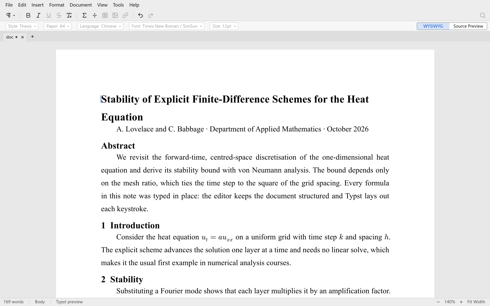
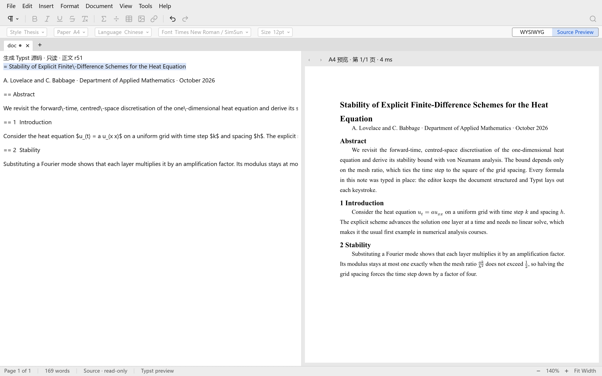
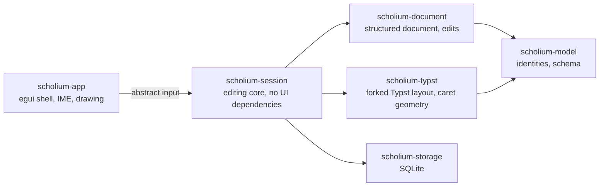

<div align="center">

# Scholium

**A native editor for scientific writing. You type on the typeset page, mathematics included.**

[](https://github.com/scholium-app/scholium/actions/workflows/rust.yml)
[](#license)
[](rust-toolchain.toml)


[What works](#what-works-today) · [Getting started](#getting-started) · [Roadmap](#roadmap) · [How it works](#how-it-works) · [中文](README.zh-CN.md)

<picture>
  <source media="(prefers-color-scheme: dark)" srcset="docs/assets/readme/editor-dark.png">
  
</picture>

<sub>The real application. The paper above was typed into it by a script: the text was pasted and every formula was entered key by key.</sub>

</div>

## Why Scholium

LaTeX and Typst produce beautiful documents, but you write code and look at the result somewhere else.
Word processors put you on the page, but mathematics comes out as an afterthought.

Scholium puts you on the typeset page. Every keystroke goes into a structured document, and
[Typst](https://typst.app) lays it out immediately. There is no approximate on-screen copy that is later replaced
by the real layout: what you edit is the typeset result. Formulas are trees with real slots for numerators,
superscripts and subscripts, not strings of markup. The document stays exportable to plain Typst source at all
times.

> A *scholium* is a note written in the margin of a classical manuscript. The scholia to Euclid's *Elements* are
> among the most important sources we have for the history of Greek mathematics.

## What works today

- **Editing on the typeset page.** Paragraphs, two heading levels, bold and emphasis, selection across
  paragraphs, cut, copy and paste.
- **Mathematics as structure.** `$` opens an inline formula, `^` and `_` open superscript and subscript slots,
  `Ctrl+/` turns what you typed into a numerator, the arrow keys move between slots, and `Esc` leaves the formula.
- **One renderer.** Typst draws everything you have committed, through a fork that reports caret positions and
  formula slots. The fork's patches are rebuilt and checked against upstream Typst in CI, pixel for pixel.
- **Chinese and English.** IME input, mixed-script line breaking and CJK punctuation; the interface is available
  in English and Simplified Chinese.
- **Source next to the page.** `Ctrl+Shift+M` shows the generated Typst source beside an A4 preview; click the
  preview to jump to the block.
- **Undo that matches how you type.** A typing run undoes as one step, and so does a formula operation.
- **Saved locally.** `Ctrl+S` writes the document and its edit journal to SQLite and restores both on the next
  start.
- **A native desktop app.** Written in Rust with egui, with no web view; light and dark themes; screen-reader
  access to body text and formulas through AT-SPI on Linux.

<p align="center">
  <picture>
    <source media="(prefers-color-scheme: dark)" srcset="docs/assets/readme/source-dark.png">
    
  </picture>
</p>

## Getting started

Scholium is pre-alpha. It is fine for trying out the editing model, but it is not ready for documents you care
about.

You need Linux with X11 or Wayland and working OpenGL/EGL drivers. On Debian or Ubuntu:

```bash
sudo apt install libxkbcommon-dev libwayland-dev libegl1-mesa-dev
git clone https://github.com/scholium-app/scholium.git
cd scholium
cargo run -p scholium-app
```

With [rustup](https://rustup.rs) installed, the pinned toolchain (`rust-toolchain.toml`, Rust 1.99) is fetched on the first build. The first build compiles Typst
and takes a few minutes. Fonts, including CJK fonts, are bundled.

| Keys | Action |
| --- | --- |
| `$` or `Ctrl+M` | Start an inline formula; `Ctrl+M` or `Esc` leaves it |
| `^` / `_` | Superscript / subscript slot |
| `Ctrl+/` | Fraction |
| `Ctrl+B` / `Ctrl+I` | Bold / emphasis, on the selection or on what you type next |
| `Ctrl+0` / `Ctrl+1` / `Ctrl+2` | Body text / heading 1 / heading 2 |
| `Ctrl+Z` / `Ctrl+Shift+Z` | Undo / redo |
| `Ctrl+Shift+M` | Switch between the page and the source view |
| `Ctrl+J` / `Ctrl+Shift+B` | Diagnostics panel / navigation |
| `Ctrl+F1` | Show or hide the toolbars |
| `Ctrl++` / `Ctrl+-` | Zoom |
| `Ctrl+S` | Save |

## Roadmap

Each project is either a Typst project or a LaTeX project, and two separate editing kernels share one
application ([ADR 0041](docs/adr/ADR-0041-separate-latex-typst-kernels.md)).

| Area | Status |
| --- | --- |
| Typst kernel: structured editing on the typeset page | **Working**, see above |
| Typst kernel: pagination, editable source, PDF export | Next |
| LaTeX kernel: `.tex` projects with a live preview produced by LuaLaTeX itself, sandboxed | Evaluated and decided ([ADR 0043](docs/adr/ADR-0043-rtex-live-preview.md)); implementation next |
| LaTeX ↔ Typst conversion with a per-node fidelity report | Planned |
| History: checkpoints, branches, undo that only reverts your own edits | Planned |
| Local-first collaboration over CRDTs ([Loro](https://loro.dev)) | Validated in prototypes; planned |

The full plan, with exit criteria for each stage, is in [docs/plan/ROADMAP.md](docs/plan/ROADMAP.md).

## How it works



- **One authoritative model.** A native project's truth is its structured document; a source project's truth
  is its source files. Nothing keeps two writable copies in sync.
- **Typst draws what you commit.** The UI never fakes typed text; it shows Typst's layout of the current
  revision, and stale layouts are never shown as current.
- **The editing core has no UI.** Keys, text and pointer events become abstract input to `scholium-session`, so
  editing behaviour is tested without a window; real-window checks drive the actual app under Xvfb.
- **Decisions are written down.** Architecture decisions live in [docs/adr](docs/adr/README.md); the design starts
  at [docs/README.md](docs/README.md).

## Contributing

Issues and pull requests are welcome. Most project documents are written in Chinese. Before you start:

- Read [AGENT.md](AGENT.md) for the hard constraints, the size limits and the checks that CI runs.
- Sign off every commit (`git commit -s`, [DCO](DCO)).
- New dependencies must pass `cargo deny` under the licence policy in AGENT.md.

## License

Dual-licensed under [MIT](LICENSE-MIT) or [Apache-2.0](LICENSE-APACHE), at your option.
