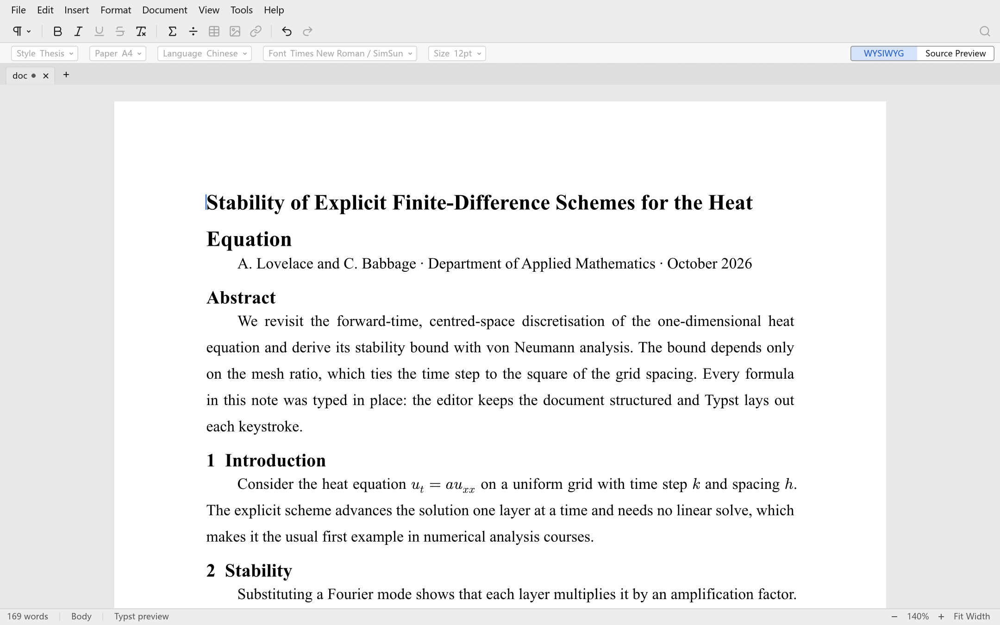
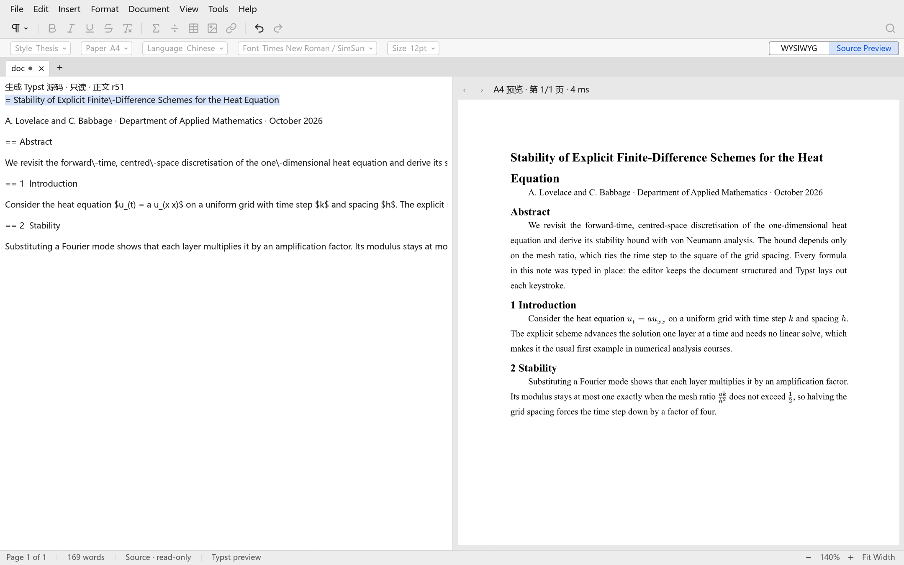
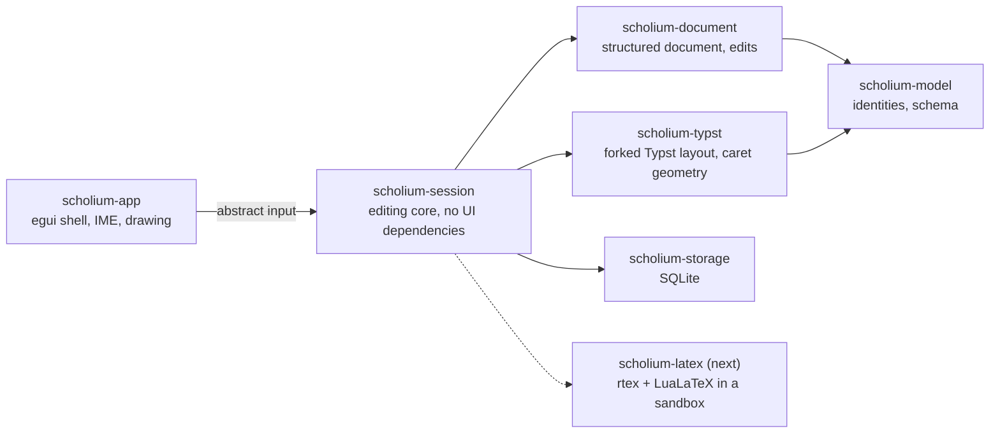

<div align="center">

# Scholium

**A local-first LaTeX writing workspace. Change a paragraph and see the real LuaLaTeX output in milliseconds.**

[](https://github.com/scholium-app/scholium/actions/workflows/rust.yml)
[](#license)
[](rust-toolchain.toml)


[Why](#why-scholium) · [What works](#what-works-today) · [Getting started](#getting-started) · [Roadmap](#roadmap) · [How it works](#how-it-works) · [中文](README.zh-CN.md)

<picture>
  <source media="(prefers-color-scheme: dark)" srcset="docs/assets/readme/editor-dark.png">
  
</picture>

<sub>The real application today, running its Typst kernel. The paper was typed into it by a script: the text was
pasted and every formula was entered key by key. The LaTeX kernel is the next milestone.</sub>

</div>

## Why Scholium

LaTeX produces the best paper layouts, but a one-character fix still means recompiling the whole document,
paging to the right spot and reading a log that points somewhere else. Faster previews usually swap in a different
engine, so what you see is not what you will publish.

Scholium keeps you in LaTeX and removes the wait:

- **Your project stays a LaTeX project.** Existing `.tex` projects open as they are; templates, packages and
  bibliographies are not rewritten, and the project still builds without Scholium.
- **The preview is the real output.** [rtex](https://github.com/HenryXiaoYang/realtime-tex) keeps a LuaLaTeX
  process running and re-lays out only the paragraph you edited. In our sandboxed evaluation of a 100-page document,
  a keystroke reached the redrawn paragraph in 19.4 ms at the median and 52.1 ms at p95, against 9.5 s for a full
  converged build; the live results matched a full compile glyph for glyph. When you pause, the same engine runs a
  full build in the background and that build always wins.
- **Edit the source or the page.** Source preview puts the `.tex` next to the typeset pages; page editing lets you
  change formulas directly on the page and writes a minimal patch back to the source.
- **Fast mathematics.** Formula input in the style of [Liii STEM](https://liiistem.cn/docs/guide-equation):
  short character combinations (`<=` gives ⩽, `RR` gives ℝ), Tab to cycle through similar symbols, `\` commands with
  completion, and formulas as structures with real slots.

The same application also has a **Typst kernel** for native structured documents, where every keystroke goes into
a structured document and Typst lays it out immediately. Each project is either LaTeX or Typst, and both kernels are
delivered stage by stage together ([ADR 0041](docs/adr/ADR-0041-separate-latex-typst-kernels.md)).

> A *scholium* is a note written in the margin of a classical manuscript. The scholia to Euclid's *Elements* are
> among the most important sources we have for the history of Greek mathematics.

## What works today

The shared base and the Typst kernel run in the app now. The LaTeX kernel has been evaluated and decided, and its
implementation is the next milestone.

**Typst kernel and shared base**

- **Editing on the typeset page.** Paragraphs, two heading levels, bold and emphasis, selection across
  paragraphs, cut, copy and paste.
- **Mathematics as structure.** Inline and display formulas with fractions, roots, auto-sizing delimiters,
  superscripts and subscripts, entered from the keyboard. The caret stops inside and around every structure, and
  Backspace walks into a structure before it deletes anything.
- **One renderer.** Typst draws everything you have committed, including the IME pre-edit text, through a fork that
  reports caret positions and formula slots. The fork's patches are rebuilt and checked against upstream Typst in CI,
  pixel for pixel.
- **Chinese and English.** IME input, mixed-script line breaking and CJK punctuation; the interface is available
  in English and Simplified Chinese.
- **Source next to the page.** A source view shows the generated Typst source beside an A4 preview; click the
  preview to jump to the block.
- **Undo that matches how you type.** A typing run undoes as one step, and so does a formula operation.
- **Saved locally.** The document and its edit journal are saved to SQLite and restored on the next start.
- **A native desktop app.** Written in Rust with egui, with no web view; light and dark themes; screen-reader
  access to body text and formulas through AT-SPI on Linux.

**LaTeX kernel: evaluated, implementation next**

- rtex runs inside an OS sandbox: the project is read-only, the build directory is writable, and there is no network
  and no access to your home directory. Attacks that read or write host files outside the sandbox were all blocked
  inside it.
- Chinese documents (ctex, luatexja) take the live path; XeLaTeX and pdfLaTeX projects get a background-build preview.
- Evaluation details: [round 1](docs/log/2026-10-30-rtex-evaluation.md), [round 2](docs/log/2026-10-30-rtex-evaluation-2.md),
  decision in [ADR 0043](docs/adr/ADR-0043-rtex-live-preview.md). The pinned rtex commit and its re-check script are in
  [spikes/rtex-eval](spikes/rtex-eval/README.md).

<p align="center">
  <picture>
    <source media="(prefers-color-scheme: dark)" srcset="docs/assets/readme/source-dark.png">
    
  </picture>
</p>

## Getting started

Scholium is pre-alpha. It is fine for trying out the editing model, but it is not ready for documents you care
about, and it does not open `.tex` projects yet.

You need Linux with X11 or Wayland and working OpenGL/EGL drivers. On Debian or Ubuntu:

```bash
sudo apt install libxkbcommon-dev libwayland-dev libegl1-mesa-dev
git clone https://github.com/scholium-app/scholium.git
cd scholium
cargo run -p scholium-app
```

With [rustup](https://rustup.rs) installed, the pinned toolchain (`rust-toolchain.toml`, Rust 1.99) is fetched on the first build. The first build compiles Typst
and takes a few minutes. Fonts, including CJK fonts, are bundled.

## Roadmap

Every stage delivers a shared base, a LaTeX track and a Typst track, and a stage is done only when all three pass.

| Stage | LaTeX | Typst | Shared |
| --- | --- | --- | --- |
| 1. Open, edit, preview, save, export | `.tex` projects with rtex live preview and background builds, sandboxed | Page editing basics (**mostly working**), `.typ` source editing, PDF | Project and file commands, storage and recovery, source editor, keymap, math input engine, `\` commands |
| 2. Locate, diagnose, input fast | Page ↔ source navigation, diagnostics, completion, outline, multi-file projects | Full math structures, document structures, paginated editing | Command completion, outline, BibTeX, magic paste |
| 3. Edit on the page | Formulas edited on the page, written back to `.tex` | Full source studio | LaTeX adapter of the math input engine |

Then, for both kernels:

4. **History**: checkpoints, branches, and undo that only reverts your own edits.
5. **Collaboration**: local-first collaboration over CRDTs ([Loro](https://loro.dev)); offline edits merge on reconnect.
6. **Conversion and release**: LaTeX ↔ Typst conversion with a per-node fidelity report, more export formats, and
   releases on three platforms.

The full plan, with exit criteria for each stage, is in [docs/plan/ROADMAP.md](docs/plan/ROADMAP.md); math input is
planned in [docs/plan/MATH_INPUT.md](docs/plan/MATH_INPUT.md).

## How it works



- **One authoritative model.** A LaTeX project's truth is its `.tex` files; a native Typst project's truth is its
  structured document. Nothing keeps two writable copies in sync.
- **The project's own engine draws the page.** LaTeX projects are previewed by LuaLaTeX (or a background build for
  other engines), Typst projects by Typst. One language never previews the other, and stale layouts are never shown
  as current.
- **The editing core has no UI.** Keys, text and pointer events become abstract input to `scholium-session`, so
  editing behaviour is tested without a window; real-window checks drive the actual app under Xvfb.
- **Decisions are written down.** Architecture decisions live in [docs/adr](docs/adr/README.md); the design starts
  at [docs/README.md](docs/README.md).

## Contributing

Issues and pull requests are welcome. Most project documents are written in Chinese. Before you start:

- Read [AGENT.md](AGENT.md) for the hard constraints, the size limits and the checks that CI runs.
- Sign off every commit (`git commit -s`, [DCO](DCO)).
- New dependencies must pass `cargo deny` under the licence policy in AGENT.md.

## License

Dual-licensed under [MIT](LICENSE-MIT) or [Apache-2.0](LICENSE-APACHE), at your option.
