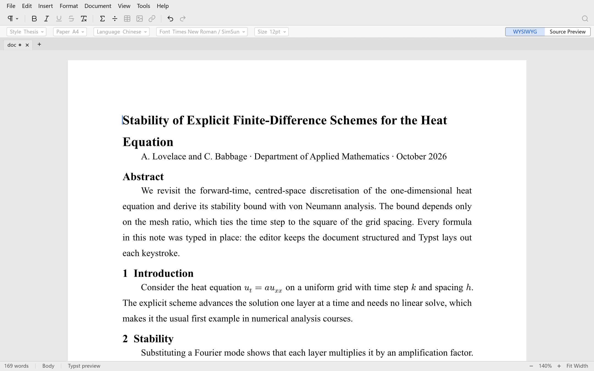
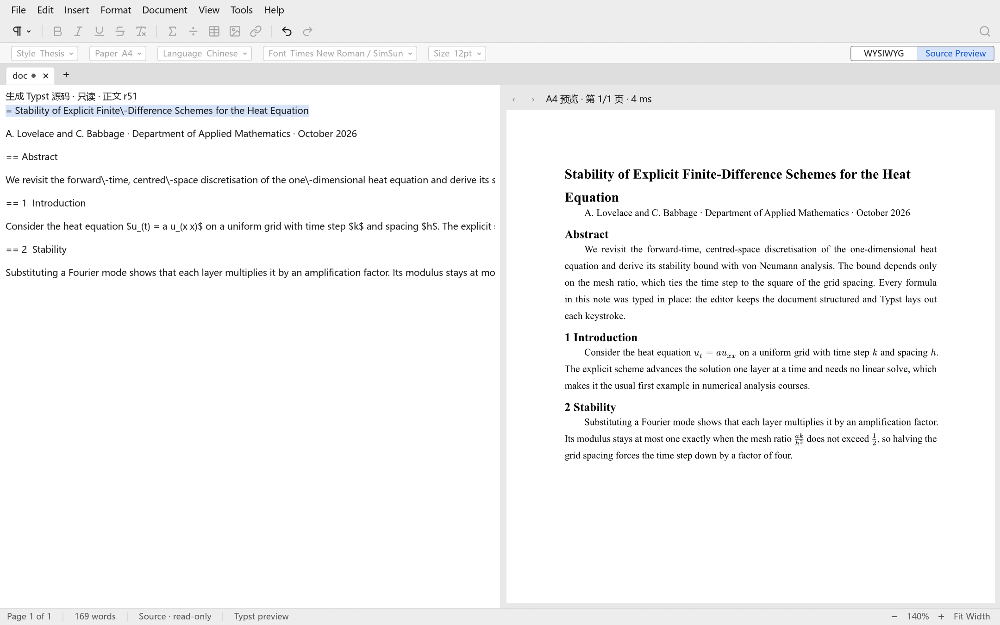
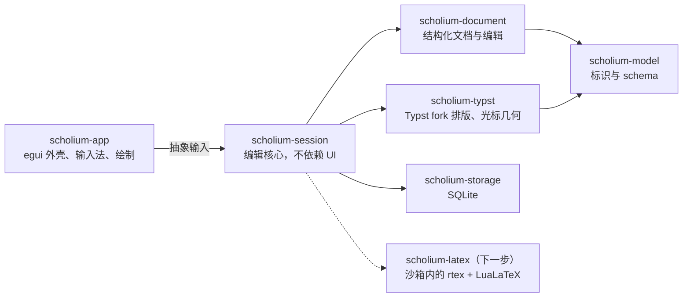

<div align="center">

# Scholium

**本地优先的 LaTeX 写作工作区：改一段，毫秒级看到真正的 LuaLaTeX 排版结果。**

[](https://github.com/scholium-app/scholium/actions/workflows/rust.yml)
[](#许可证)
[](rust-toolchain.toml)


[为什么做](#为什么做-scholium) · [现在能做什么](#现在能做什么) · [快速开始](#快速开始) · [路线图](#路线图) · [工作原理](#工作原理) · [English](README.md)

<picture>
  <source media="(prefers-color-scheme: dark)" srcset="docs/assets/readme/editor-dark.png">
  
</picture>

<sub>当前真实运行的应用，运行的是 Typst 内核。这篇论文由脚本输入：正文通过粘贴，每个公式都逐键敲入。LaTeX 内核是下一个里程碑。</sub>

</div>

## 为什么做 Scholium

LaTeX 能排出最好的论文版面，但改一个字符也要整篇重新编译，再翻页找到位置，日志还常常指向别处。
更快的预览往往换了一个引擎，看到的并不是最终要发表的结果。

Scholium 让你留在 LaTeX 里，同时不再等待：

- **项目还是标准 LaTeX 项目。** 已有 `.tex` 项目原样打开，模板、宏包和参考文献都不改写；离开 Scholium 照样能编译。
- **预览就是最终输出。** [rtex](https://github.com/HenryXiaoYang/realtime-tex) 让一个常驻的 LuaLaTeX 只重排被修改的段落。
  在我们沙箱内的评估中，100 页文档从击键到该段重新绘制，中位数 19.4 ms、p95 52.1 ms，而同一文档完整排版收敛要 9.5 s；
  实时结果与完整编译逐字形一致。停笔后同一引擎在后台完整编译，结果不一致时以完整编译为准。
- **改源码，也能改页面。** 源码预览把 `.tex` 和排版页面并排放；页面编辑可以直接在页面上改公式，并以最小补丁写回源码。
- **高速数学输入。** 借鉴 [Liii STEM](https://liiistem.cn/docs/guide-equation) 的公式输入：短字符组合（`<=` 得 ⩽、`RR` 得 ℝ）、
  Tab 在形似符号间循环、带补全的 `\` 命令，公式是带真实槽位的结构。

同一个应用里还有面向原生结构文档的 **Typst 内核**：每次按键都进入结构化文档，并立即由 Typst 排版。每个项目固定为
LaTeX 或 Typst，两个内核按阶段同步交付（[ADR 0041](docs/adr/ADR-0041-separate-latex-typst-kernels.md)）。

> *scholium*（复数 *scholia*）是古典手稿页边的注疏。欧几里得《几何原本》的注疏是希腊数学史最重要的传世材料之一。

## 现在能做什么

共享底座和 Typst 内核已经能在应用里运行。LaTeX 内核已经完成评估和选型，实现是下一个里程碑。

**Typst 内核与共享底座**

- **在排版页面上编辑。** 段落、两级标题、粗体与强调、跨段选区、剪切复制粘贴。
- **公式是结构。** 行内公式与独立公式，支持分数、根式、自动伸缩的定界符和上下标，全部用键盘输入。
  光标在每个结构的内部和前后都有停点，退格会先逐层进入结构，遇到可删的内容才删除。
- **只有一个渲染器。** 已提交的内容（包括输入法的预编辑文字）全部由 Typst 绘制；我们维护一个能报告光标位置与公式槽位的
  Typst fork，CI 会从上游源码重建它，并与原版 Typst 逐像素比对。
- **中英文。** 支持输入法、中英混排断行与中文标点挤压；界面提供简体中文与英文。
- **源码就在页面旁边。** 源码视图并排显示生成的 Typst 源码与 A4 预览，点击预览可跳到对应段落。
- **撤销符合打字习惯。** 连续输入撤销为一步，一次公式操作也撤销为一步。
- **本地保存。** 文档和编辑日志保存到 SQLite，下次启动时恢复。
- **原生桌面应用。** Rust + egui，不用 WebView；浅色与深色主题；Linux 上通过 AT-SPI 支持屏幕阅读器朗读正文与公式。

**LaTeX 内核：已评估，下一步实现**

- rtex 运行在 OS 沙箱内：项目只读、构建目录可写、无网络、看不到用户目录。在沙箱外能读写宿主文件的攻击，在沙箱内全部被挡住。
- 中文文档（ctex、luatexja）走实时路径；XeLaTeX 与 pdfLaTeX 项目以后台完整编译作为预览。
- 评估细节见[第一轮](docs/log/2026-10-30-rtex-evaluation.md)、[第二轮](docs/log/2026-10-30-rtex-evaluation-2.md)，选型见
  [ADR 0043](docs/adr/ADR-0043-rtex-live-preview.md)；锁定的 rtex 提交与复验脚本见 [spikes/rtex-eval](spikes/rtex-eval/README.md)。

<p align="center">
  <picture>
    <source media="(prefers-color-scheme: dark)" srcset="docs/assets/readme/source-dark.png">
    
  </picture>
</p>

## 快速开始

Scholium 处于 pre-alpha 阶段：适合体验编辑方式，还不适合存放重要文档，目前也还不能打开 `.tex` 项目。

需要 Linux（X11 或 Wayland）以及可用的 OpenGL/EGL 驱动。在 Debian 或 Ubuntu 上：

```bash
sudo apt install libxkbcommon-dev libwayland-dev libegl1-mesa-dev
git clone https://github.com/scholium-app/scholium.git
cd scholium
cargo run -p scholium-app
```

装好 [rustup](https://rustup.rs) 后，首次构建会自动获取锁定的工具链（`rust-toolchain.toml`，Rust 1.99）。
首次构建要编译 Typst，需要几分钟。字体（含中文字体）随应用打包。

## 路线图

每个阶段同时交付共享底座、LaTeX 轨和 Typst 轨，三部分都通过才算完成。

| 阶段 | LaTeX | Typst | 共享底座 |
| --- | --- | --- | --- |
| 1. 打开、编辑、预览、保存、输出 | `.tex` 项目：rtex 实时预览与后台完整编译，运行在沙箱内 | 页面编辑基础（**大部分已可用**）、`.typ` 源码编辑、PDF | 项目与文件命令、存储与恢复、源码编辑器、键位表、数学输入引擎、`\` 命令 |
| 2. 定位、诊断、高效输入 | 页面 ↔ 源码定位、诊断、补全、大纲、多文件项目 | 数学结构全集、文档结构、分页编辑面 | 命令补全、大纲、BibTeX、魔法粘贴 |
| 3. 在页面上编辑 | 在页面上编辑公式并写回 `.tex` | 完整源码工作台 | 数学输入引擎的 LaTeX 适配器 |

之后两个内核一起推进：

4. **历史**：检查点、分支、只撤销自己的修改。
5. **协作**：基于 CRDT（[Loro](https://loro.dev)）的本地优先协作，离线修改重连后合并。
6. **转换与发布**：LaTeX ↔ Typst 转换并逐节点报告保真度、更多导出格式、三平台发布。

完整计划及各阶段出口条件见 [docs/plan/ROADMAP.md](docs/plan/ROADMAP.md)，数学输入见 [docs/plan/MATH_INPUT.md](docs/plan/MATH_INPUT.md)。

## 工作原理



- **一个权威模型。** LaTeX 项目以 `.tex` 文件为准，Typst 原生项目以结构化文档为准；不维护两份互相同步的可写副本。
- **页面由项目自己的引擎绘制。** LaTeX 项目由 LuaLaTeX 预览（其他引擎用后台完整编译），Typst 项目由 Typst 预览；
  不用一种语言预览另一种语言，旧的排版结果不会被当作最新显示。
- **编辑核心不依赖 UI。** 按键、文字与指针事件都转成 `scholium-session` 的抽象输入，因此编辑行为可以脱离窗口测试；
  真实窗口检查则在 Xvfb 下驱动真正的应用。
- **决策都有记录。** 架构决策见 [docs/adr](docs/adr/README.md)，设计文档从 [docs/README.md](docs/README.md) 开始。

## 参与贡献

欢迎提 issue 和 PR。开始之前：

- 阅读 [AGENT.md](AGENT.md)：硬性约束、规模上限与 CI 检查项。
- 每个提交都要签署（`git commit -s`，[DCO](DCO)）。
- 新增依赖必须按 AGENT.md 的许可证政策通过 `cargo deny`。

## 许可证

以 [MIT](LICENSE-MIT) 或 [Apache-2.0](LICENSE-APACHE) 双许可发布，任选其一。
