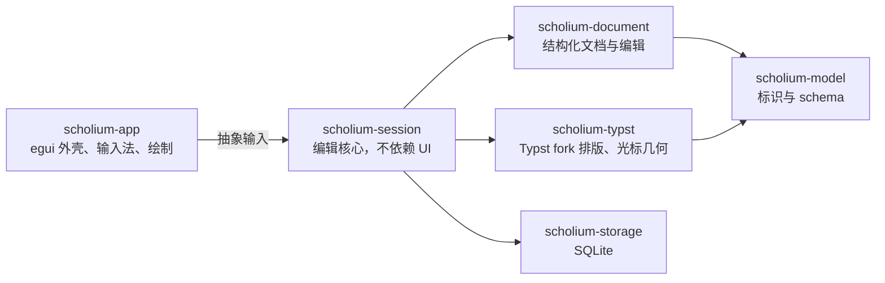

<div align="center">

# Scholium

**面向科学写作的原生编辑器：直接在排好版的页面上写作，公式也一样。**

[](https://github.com/scholium-app/scholium/actions/workflows/rust.yml)
[](#许可证)
[](rust-toolchain.toml)


[现在能做什么](#现在能做什么) · [快速开始](#快速开始) · [路线图](#路线图) · [工作原理](#工作原理) · [English](README.md)

<picture>
  <source media="(prefers-color-scheme: dark)" srcset="docs/assets/readme/editor-dark.png">
  
</picture>

<sub>真实运行的应用。这篇论文由脚本输入：正文通过粘贴，每个公式都逐键敲入。</sub>

</div>

## 为什么做 Scholium

LaTeX 和 Typst 排版精美，但你写的是代码，效果要到另一个窗口才看得到。文字处理软件让你直接在页面上写，
数学却总是二等公民。

Scholium 让你直接在排好版的页面上写。每次按键都进入一份结构化文档，并立即由 [Typst](https://typst.app)
排版：你编辑的就是最终排版结果，而不是一份临时近似、事后再被替换的屏幕副本。公式是带有分子、上标、下标
等真实槽位的结构，而不是一串标记字符。文档随时可以导出为普通的 Typst 源码。

> *scholium*（复数 *scholia*）是古典手稿页边的注疏。欧几里得《几何原本》的注疏是希腊数学史最重要的传世材料之一。

## 现在能做什么

- **在排版页面上编辑。** 段落、两级标题、粗体与强调、跨段选区、剪切复制粘贴。
- **公式是结构。** 行内公式中的分数、上下标都在书写时直接用键盘输入，光标可在各个槽位间移动。
- **只有一个渲染器。** 已提交的内容全部由 Typst 绘制；我们维护一个能报告光标位置与公式槽位的 Typst fork，
  CI 会从上游源码重建它，并与原版 Typst 逐像素比对。
- **中英文。** 支持输入法、中英混排断行与中文标点挤压；界面提供简体中文与英文。
- **源码就在页面旁边。** 源码视图并排显示生成的 Typst 源码与 A4 预览，点击预览可跳到对应段落。
- **撤销符合打字习惯。** 连续输入撤销为一步，一次公式操作也撤销为一步。
- **本地保存。** 文档和编辑日志保存到 SQLite，下次启动时恢复。
- **原生桌面应用。** Rust + egui，不用 WebView；浅色与深色主题；Linux 上通过 AT-SPI 支持屏幕阅读器朗读正文与公式。

<p align="center">
  <picture>
    <source media="(prefers-color-scheme: dark)" srcset="docs/assets/readme/source-dark.png">
    
  </picture>
</p>

## 快速开始

Scholium 处于 pre-alpha 阶段：适合体验编辑方式，还不适合存放重要文档。

需要 Linux（X11 或 Wayland）以及可用的 OpenGL/EGL 驱动。在 Debian 或 Ubuntu 上：

```bash
sudo apt install libxkbcommon-dev libwayland-dev libegl1-mesa-dev
git clone https://github.com/scholium-app/scholium.git
cd scholium
cargo run -p scholium-app
```

装好 [rustup](https://rustup.rs) 后，首次构建会自动获取锁定的工具链（`rust-toolchain.toml`，Rust 1.99）。
首次构建要编译 Typst，需要几分钟。字体（含中文字体）随应用打包。

## 路线图

每个项目要么是 Typst 项目，要么是 LaTeX 项目，由两个独立的编辑内核承担，共用同一个应用
（[ADR 0041](docs/adr/ADR-0041-separate-latex-typst-kernels.md)）。

| 方向 | 状态 |
| --- | --- |
| Typst 内核：在排版页面上结构化编辑 | **可用**，见上文 |
| Typst 内核：分页、可编辑源码、PDF 导出 | 下一步 |
| LaTeX 内核：`.tex` 项目，预览由 LuaLaTeX 自身实时产生，运行在沙箱内 | 已评估并裁决（[ADR 0043](docs/adr/ADR-0043-rtex-live-preview.md)），下一步实现 |
| LaTeX ↔ Typst 转换，逐节点报告保真度 | 计划中 |
| 历史：检查点、分支、只撤销自己的修改 | 计划中 |
| 基于 CRDT（[Loro](https://loro.dev)）的本地优先协作 | 原型已验证，计划中 |

完整计划及各阶段出口条件见 [docs/plan/ROADMAP.md](docs/plan/ROADMAP.md)。

## 工作原理



- **一个权威模型。** 原生项目以结构化文档为准，源码项目以源文件为准；不维护两份互相同步的可写副本。
- **已提交的内容由 Typst 绘制。** 界面从不伪造输入的文字，只显示当前版本的 Typst 排版，旧的排版结果不会被当作最新显示。
- **编辑核心不依赖 UI。** 按键、文字与指针事件都转成 `scholium-session` 的抽象输入，因此编辑行为可以脱离窗口测试；
  真实窗口检查则在 Xvfb 下驱动真正的应用。
- **决策都有记录。** 架构决策见 [docs/adr](docs/adr/README.md)，设计文档从 [docs/README.md](docs/README.md) 开始。

## 参与贡献

欢迎提 issue 和 PR。开始之前：

- 阅读 [AGENT.md](AGENT.md)：硬性约束、规模上限与 CI 检查项。
- 每个提交都要签署（`git commit -s`，[DCO](DCO)）。
- 新增依赖必须按 AGENT.md 的许可证政策通过 `cargo deny`。

## 许可证

以 [MIT](LICENSE-MIT) 或 [Apache-2.0](LICENSE-APACHE) 双许可发布，任选其一。
