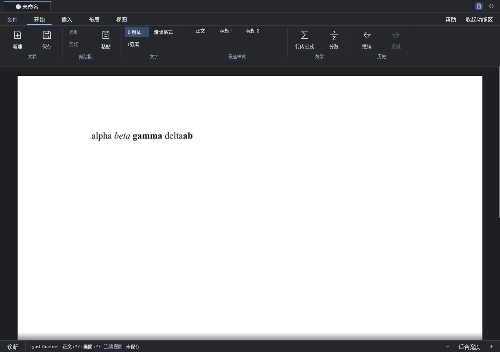

# 选区粗体/强调与输入样式

> 本文是第 1 阶段实现的追溯记录（过去时），不是阶段 0 验证证据，也不作为实现依据；当前规范见 `docs/modules/` 与 `docs/adr/`。

- 日期：2026-10-12；范围：粗体/强调的范围样式与输入样式；粗体加强调叠加不可表示。
- 相关：[P1 排版工作区规划](../plan/P1_UI.md)的文字格式、[文档模块](../modules/document.md)的结构请求。
- 基线：main `fc31bce`；分支 `ation_ciger/feat/inline-styles`。

## 问题

`SetTextStyle` 只能给整个文字叶设样式：无选区时“粗体”会让整段变粗，一个词不能单独加粗，
也没有 Ctrl+B / Ctrl+I。有选区时 Ribbon 样式命令只显示“尚未接入”。

## 改动

- `StructuralEdit::SetRangeStyle { start, end, style }`（`scholium-document/structured_session/style.rs`）：
  端点同 `ReplaceBodyRange` 的 `BodyTextPosition`。在两端拆分 Text 叶，给范围内每个 Text 叶设样式
  （数学/Raw inline 不动，可跨块），再合并受影响片段旁样式相同的 Text 叶，保留左叶 `NodeId`。
  空范围或样式不变为 no-op；整个操作是一次动作、一个 revision。`StructuralOutcome.range` 返回同一段
  文字在新叶划分下的两个端点，选区因此保持；`range_has_style` 供应用判断切换方向。
- 选区命令：范围内全部非空文字已是该样式则设为普通，否则设为该样式；“清除格式”设为普通。
  选区保持在同一段文字上，光标仍在原来的一端；整步一次撤销并还原选区。
- 无选区：命令只武装“输入样式”，下一次输入/粘贴/IME 提交的文字在光标处另成一个带该样式的叶
  （必要时拆分原叶），与插入同属一步撤销。样式绑定武装时的光标位置，光标移动、点击、Esc、产生选区或
  撤销都会解除。
- Ribbon 的粗体/强调按钮在光标叶、整个选区或输入样式带该样式时显示选中态；悬停提示写明快捷键。
- 快捷键：`Ctrl+B` 粗体、`Ctrl+I` 强调；导航面板开关改为 `Ctrl+Shift+B`（命令栏提示、README、
  app 模块文档同步）。
- 实机脚本 `spikes/typst-main-editor/inline-style-check.py`，并入 CI 窗口作业。

## 已知限制

- 模型每叶只有一种样式：粗体与强调不能叠加，对粗体文字用强调会变成强调。
- 公式内不支持文字样式，命令只给出状态栏提示。
- 输入样式的撤销折叠依赖撤销栈未达 512 步上限；达到上限时插入与样式各占一步。

## 复现

```sh
cargo test --locked --workspace
cargo build --locked -p scholium-app -p scholium-storage --bins
xvfb-run -a -s '-screen 0 1280x900x24' \
  python3 spikes/typst-main-editor/inline-style-check.py target/debug/scholium-app /tmp/scholium-inline-style
```

## 结果

| 检查 | 结果与证据 |
|---|---|
| 回归 | **262 passed / 0 failed**（workspace）；[tests.log](evidence/inline-styles/tests.log) |
| 文档层 | 7 项：单叶三段拆分且左叶保身份、跨叶且中间公式不变、跨块、整段已设样式时切回并合并、与相邻同样式叶合并、远处同样式叶不合并、no-op 与非法端点（反向/字素内/公式端点）不改文档 |
| 应用层 | 11 项（另改写既有的选区格式测试 1 项）：选中一个词 Ctrl+B 只加粗该词并保持选区、Ctrl+I 把粗体改强调与清除格式、选区样式一步撤销并还原选区、范围拆分后每个字素边界 caret 仍精确（保持 #44 的 TextElem origin）、输入样式新建 Strong 叶、叶中间拆分且一步撤销、输入样式关闭与在粗体中输入普通、光标移动/Esc/选区解除、IME 提交遵守输入样式、Ribbon 选中态、公式内拒绝；`Ctrl+Shift+B` 切导航而 `Ctrl+B` 不切 |
| 实机 | **4/4**：选中 gamma 加粗只改该词、选中 beta 强调、无选区 Ctrl+B 后输入得到 Strong 叶、移动光标后输入落回原叶；[summary.json](evidence/inline-styles/inline-style/summary.json) |
| 既有窗口流程 | native 33 步、AT-SPI 9/9、源码工作区、数学上下标、点击/多击交互、默认启动迁移、与独立 stock Typst 的像素对比仍通过 |

截图：


“alpha *beta* **gamma** delta”：beta 为强调（选中、“强调”按钮呈选中态），gamma 为粗体。


