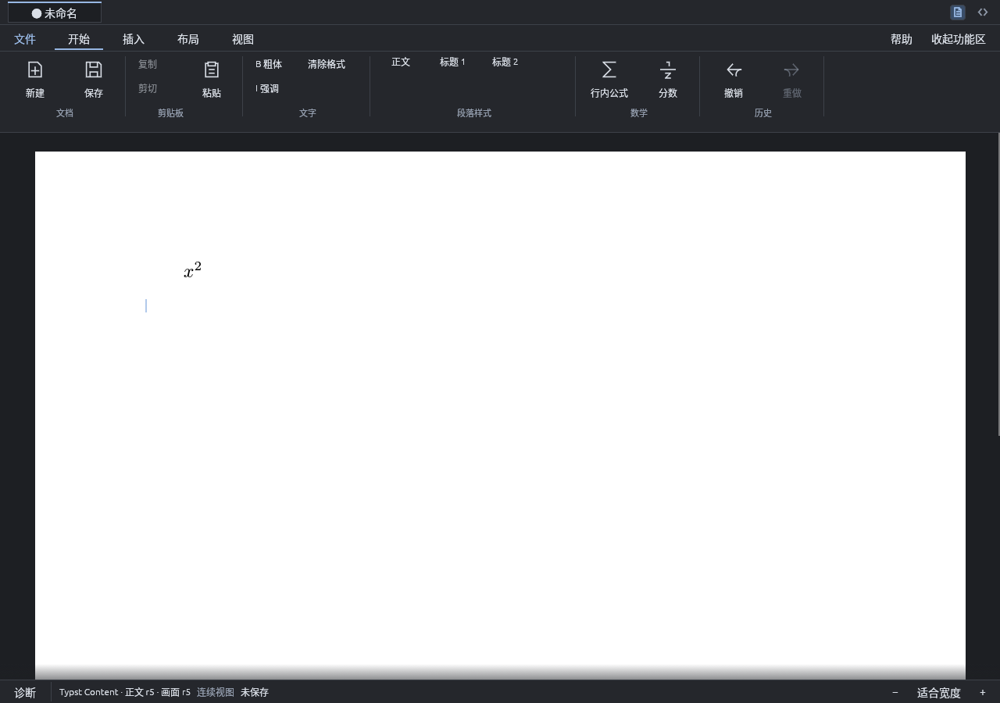
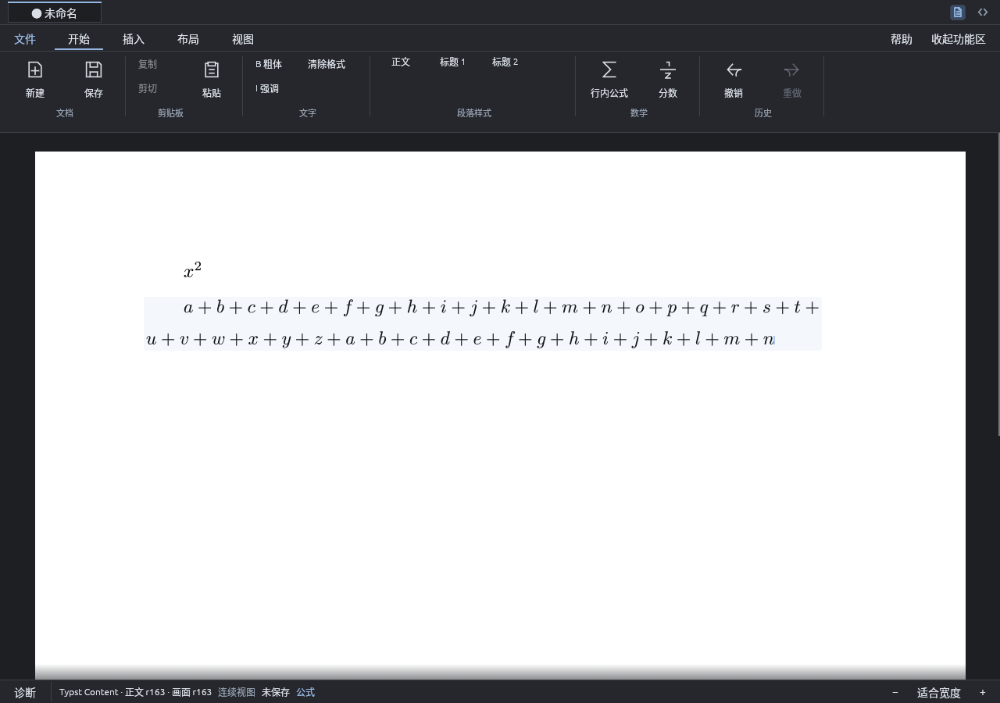
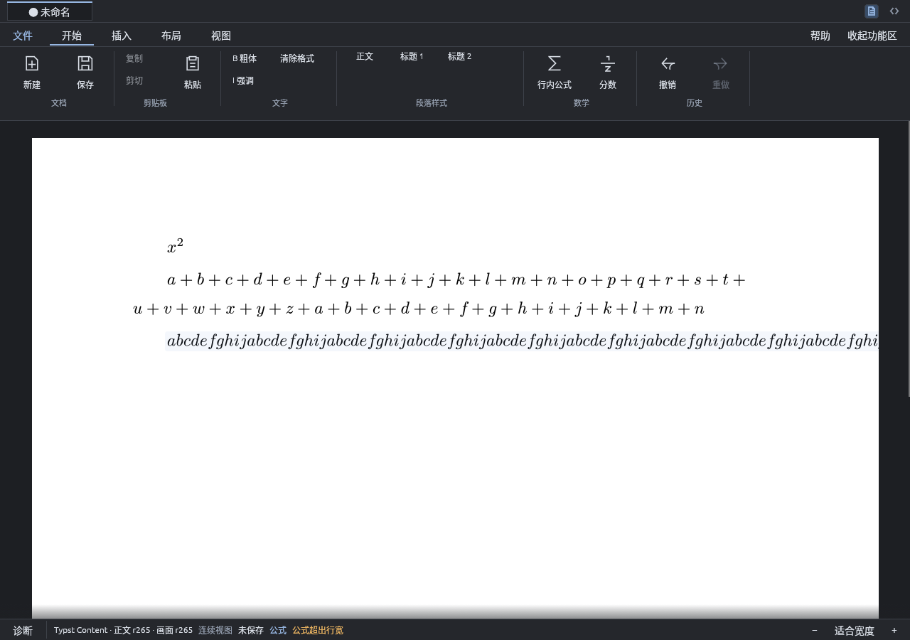
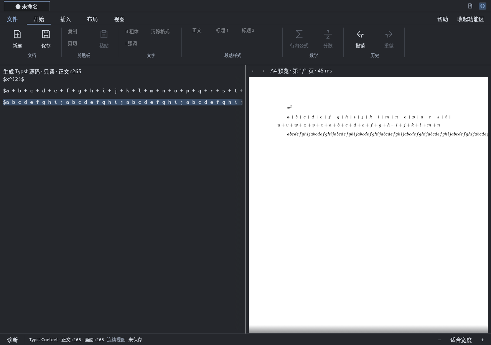

# 公式内回车与长行内公式

> 本文是第 1 阶段实现的追溯记录（过去时），不是阶段 0 验证证据，也不作为实现依据；当前规范见 `docs/modules/` 与 `docs/adr/`。

- 日期：2026-10-13；范围：Enter/Shift+Enter 在行内公式内的行为、编辑面与预览的公式断行一致性、超出行宽诊断。
- 相关：[app 模块](../modules/app.md)、[typst 模块](../modules/typst.md)。
- 基线：main `5b65c5d`；分支 `ation_ciger/fix/math-enter-wrap`。

## 问题

1. 光标在行内公式内按 Enter 没有任何反应也没有提示（`split` 对数学叶只设错误后返回）。
2. 一个很长的行内公式越过右页边距。观察到的实例是上标里误输入的无运算符长串；真实带运算符的公式是否换行需要实测而不是假设。

## 改动

- Enter 与 Shift+Enter（行内公式没有内部换行）在数学叶内：光标移到该公式所属行内之后的正文叶字节 0，
  再走普通 `ReplaceBodyRange("\n")`（即既有拆段路径，未新增文档编辑），新段从公式之后开始。
  `typst_editor/math_enter.rs`。
  - 一步撤销，撤销后光标回到按键时的公式内位置；`input.rs` 在事件入口已让 Enter 打断打字分组（#48），
    故撤销只回退拆段，不吞掉公式里刚键入的内容。
  - 未被编辑的占位 Hole（#43）：先按其生命周期移除（撤销栈弹回 LeaveSlot 之前），再拆段；
    撤销后光标回到 LeaveSlot 前的槽内位置，不会指向已消失的 Hole。
  - 公式后没有正文叶（理论上不出现）时报“公式后没有可分段的正文位置”，不静默。
- 断行实测见下表。公式含运算符时编辑面本来就会换行；唯一的差异在**键入的空格**：生成源码丢弃它
  （“空格只分隔原子”），编辑面却把它渲染成有宽度、类别为字母的原子，于是 `a + b + c …` 在编辑面一整行
  不断（越过版心）而预览正常断行。编辑面现在把空格原子渲染为字号 0（保留 caret 停靠点、不占宽），
  类别取 Normal；不改用户内容。`scholium-typst/src/editor/content.rs`。
- 无运算符长串（含上标内）在 Typst 与 TeX 中都不可断，不发明断点：光标位于该公式内且公式 bounds
  （#44 的指示器几何）右端超出版心右缘（容差 0.5 pt）时，状态栏显示“公式超出行宽”。不改写内容。
  `typst_editor/indicator.rs`（`formula_overflows`）、`typst_editor.rs`（`warning`）；审计输出新增
  `formula_overflow`。
- `spikes/typst-main-editor/math-attach-check.py` 的竞态：原先在 AUDIT 快照里一出现 `"sub"` 就断言，
  此时 `i` 还没键入，CI 里偶发失败。现在轮询直到完整的预期结构出现（20 s 超时），
  超时则对最后一个状态断言（仍以实际结构失败），断言内容未放宽。连续运行 5 次均通过。
- 实机脚本 `spikes/typst-main-editor/math-enter-check.py`，并入 CI 窗口作业。

## 断行实测

文档为 “Start ⟨公式⟩ end.” 一段，A4 版心；表中“编辑”为编辑面（Typst Content），“预览”为 A4 预览。
行文本取 Typst 的文本项（忽略空白后比较）。`parity.rs` 的两项新测试固定这些结论。

| 夹具 | 编辑面（修复前） | 编辑面（修复后） | 预览 | 一致 |
|---|---|---|---|---|
| (a) `a+b+…`，40 项无空格 | 2 行，断在第 19 项后的 `+` | 同左 | 同左 | 是（本来一致） |
| (a′) 同上但键入空格 `a + b + …` | 1 行，越过版心 | 2 行，断在第 19 项后的 `+` | 2 行，同位置 | 修复前否，修复后是 |
| (b) `a=b=…`，30 项 | 2 行，断在第 18 项后的 `=` | 同左 | 同左 | 是（本来一致） |
| (c) `x` 的上标为 104 个字母无运算符 | 整串不断，越过版心 | 同左；状态栏“公式超出行宽” | 整串不断，越过版心 | 是（均不可断） |
| (d) 104 个字母无运算符 | 整串不断，越过版心 | 同左；状态栏“公式超出行宽” | 整串不断，越过版心 | 是（均不可断） |

(c)(d) 的行布局在两个表面一致，属于排版上无法断开的内容；编辑面不剪裁地如实显示越界（页面栅格在纸面边缘截止），
并以状态栏诊断提示。

## 已知限制

- 公式内没有行内换行：Enter 只能把整个公式留在上一段。需要在公式中间断段落时，先在正文里断，再把公式移过去。
- 超出诊断只在光标位于该公式内时显示；未逐个公式做页面级标注。
- 公式后若紧跟的不是正文叶（只能由未来新增的行内类型造成），Enter 报错而不拆段。

## 复现

```sh
cargo test --locked --workspace
cargo build --locked -p scholium-app -p scholium-storage --bins
xvfb-run -a -s '-screen 0 1280x900x24' \
  python3 spikes/typst-main-editor/math-enter-check.py target/debug/scholium-app /tmp/scholium-math-enter
xvfb-run -a -s '-screen 0 1280x900x24' \
  python3 spikes/typst-main-editor/math-attach-check.py target/debug/scholium-app /tmp/scholium-math-attach
```

## 结果

| 检查 | 结果与证据 |
|---|---|
| 应用层 | `math_enter` 9 项：公式末尾、中部、上标槽内回车都在公式之后另起一段且光标在新段开头；公式后已有文字随新段移走；Shift+Enter 相同；一步撤销回到公式内原光标；打字分组被回车打断；占位 Hole 被移除且撤销回到槽内；正文回车不变。`indicator` 新增 3 项：可断长公式不报超出、无运算符串与上标串报“公式超出行宽”且离开公式后清除；[tests.log](evidence/math-enter-wrap/tests.log) |
| 排版层 | `parity` 新增 2 项：40 项和、带键入空格的和、30 项等式链在编辑面与预览的断行文本逐行相同且断在运算符之后；无运算符串与上标串在两个表面都不被拆开 |
| 实机 | **7/7**：上标内回车拆段且光标在新段开头、一次 Ctrl+Z 恢复、Shift+Enter 相同、长和式不越界、无运算符串报超出并在离开公式后清除、预览编译通过；[summary.json](evidence/math-enter-wrap/math-enter/summary.json) |
| 竞态修复 | `math-attach-check.py` 连续 5 次通过 |
| 既有窗口流程 | native、AT-SPI、源码工作区、数学上下标、点击/多击交互、sharp raster、行内样式、按词撤销、默认启动迁移与独立 stock Typst 的像素对比（4/4 像素相等）仍通过 |



上标内回车后公式留在第一段，光标在第二段开头。



带键入空格的长和式在编辑面断在运算符之后，与预览一致。



无运算符长串越过版心；状态栏显示“公式超出行宽”。



预览中和式断行位置与编辑面相同，无运算符串同样越界。
