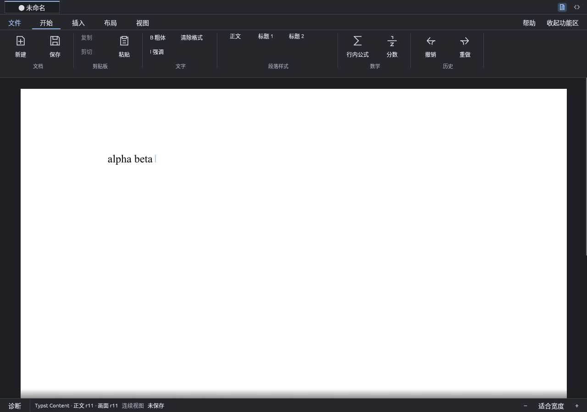

# 按词撤销输入

> 本文是第 1 阶段实现的追溯记录（过去时），不是阶段 0 验证证据，也不作为实现依据；当前规范见 `docs/modules/` 与 `docs/adr/`。

- 日期：2026-10-13；范围：单机撤销栈的输入/删除分组；协作撤销不在此范围。
- 相关：[app 模块](../modules/app.md)的单机 undo/redo。
- 基线：main `a9df8b1`；分支 `ation_ciger/feat/undo-grouping`。

## 问题

输入 “plain typing” 后按 Ctrl+Z 只得到 “plain typin”：每个按键都是一个撤销步，撤销一句话要按几十次。

## 改动

- 撤销组（`typst_editor/history.rs`）：同一叶、光标连续位置上的键入与 IME 提交共用一个撤销项，
  该项保存组内第一次插入之前的状态；组内后续插入不再入栈。
- 结束一组的条件：空白紧跟非空白（空白属于它所结束的那一组，撤销去掉“词+空格”）；两次插入间隔 ≥ 1 秒
  （`PAUSE`，时钟可注入，测试用手动时钟）；任何非插入编辑（删除、回车、粘贴、样式/结构命令、公式进出）；
  方向键/Home/End/Tab/快捷键或点击移动光标；撤销/重做。保存不打断。
- 连续 Backspace/Delete 同样合并，间隔 ≥ 1 秒打断，但不与插入合并。粘贴和结构命令仍各占一步。
- 输入样式（#45）武装后的首次输入另起一组并与武装同属一步，之后在该叶内继续键入并入同组。
- 占位 Hole 生命周期（#43）：离开占位时的“期间无其它编辑”判断按 revision 与撤销栈深度，分组下仍成立；
  已有测试全部通过，另加分组键入占位后一次撤销回到占位状态的测试。
- 撤销栈上限 512 仍按组计。
- `EditorSession::apply_outcome` 拆出 `apply_joined(edit, join, state)`；历史相关代码迁入
  `history.rs`，`typst_editor.rs` 由 527 行降到 486 行。
- 实机脚本 `spikes/typst-main-editor/undo-group-check.py`，并入 CI 窗口作业。

## 已知限制

- 真实键盘的按键同时产生 Key 与 Text 事件；只有方向、Home/End、Tab、回车、Esc 与带命令键的 Key 打断分组，
  可打印键不打断。
- 间隔以事件被处理的时刻计；排队等待排版的方向键之后的输入按出队时刻计。

## 复现

```sh
cargo test --locked --workspace
cargo build --locked -p scholium-app -p scholium-storage --bins
xvfb-run -a -s '-screen 0 1280x900x24' \
  python3 spikes/typst-main-editor/undo-group-check.py target/debug/scholium-app /tmp/scholium-undo-group
```

## 结果

| 检查 | 结果与证据 |
|---|---|
| 应用层 | 新增 13 项：按词撤销与重做、间隔 999 ms 同组而 1000 ms 另起、方向键与点击分组、Backspace×5 一步且不与输入合并、IME 提交并入而粘贴独立、结构命令打断、输入样式组、新编辑清空重做、512 上限按组计、Key+Text 并发不打断、占位内分组键入；[tests.log](evidence/undo-grouping/tests.log) |
| 实机 | **5/5**：输入 “alpha beta gamma” 后一次 Ctrl+Z 去掉最后一词、再一次去掉上一词、Ctrl+Y 恢复、移动光标后插入的字符单独撤销；[summary.json](evidence/undo-grouping/undo-group/summary.json) |
| 既有窗口流程 | native、AT-SPI、源码工作区、数学上下标、点击/多击交互、sharp raster、行内样式、默认启动迁移与独立 stock Typst 的像素对比仍通过 |



“alpha beta gamma” 一次 Ctrl+Z 后为 “alpha beta ”。
