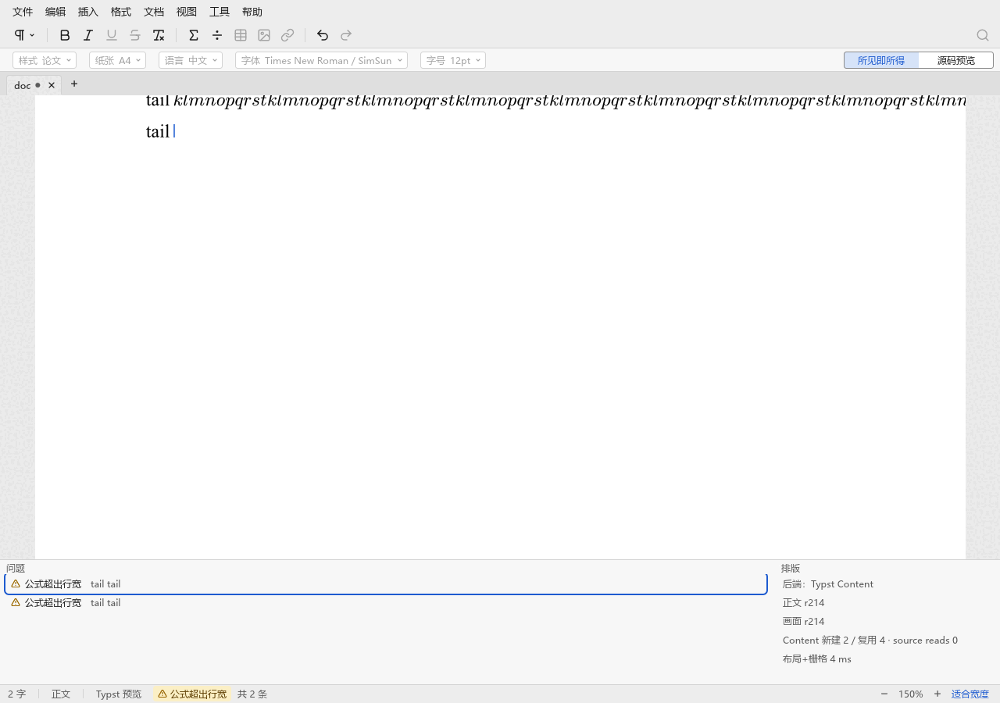
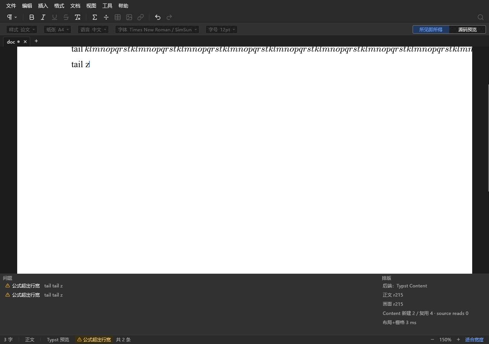
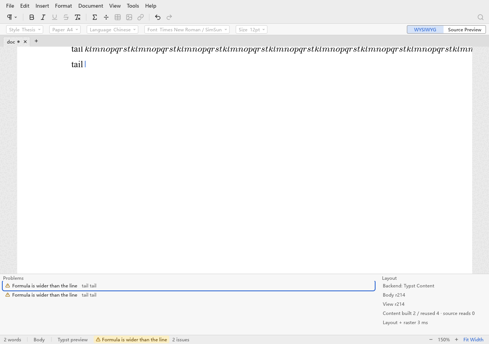
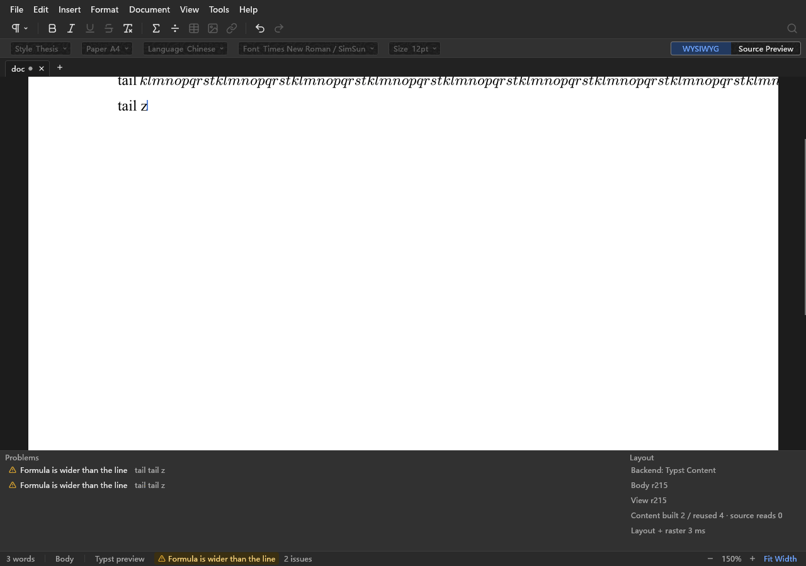

# 2026-10-15：状态栏警告跳转与诊断面板

本记录只追溯本次 PR 做了什么、怎么验证；行为规范见 [app.md](../modules/app.md#诊断)，布局基准见
[P1 排版工作区规划](../plan/P1_UI.md)，上一份记录是[窗口外壳](2026-10-14-window-chrome.md)（其“与规格的差异”里
最后两条——警告不可点击跳转、没有“共 N 条”——由本次补上）。

## 做了什么

- 新增 `diagnostics/`：`Diagnostic { severity, catalog key + 参数, 可选位置, 可选段落摘录 }`，位置是叶 `NodeId` + 字节偏移。
  列表按严重度（错误 → 警告 → 提示）排序，同级保持收集顺序。消息文字在绘制时按界面语言经 Fluent 渲染。
- 状态栏：原来的单条瞬时警告换成这份列表的第一条；多于一条时紧随其后显示“共 N 条”/“N issues”（独立按钮，开关面板）。
  点击或 Enter：有位置则移动光标并由跟随光标滚动到可见，没有位置则打开面板；悬停显示全文。
- 诊断面板：停靠在编辑区底部、状态栏之上，默认高 160，顶边可拖动，由“视图 → 诊断”（Ctrl+J）或“共 N 条”开关。
  左“问题”（图标、消息、段落摘录，点击或 Enter 跳转，空时“没有问题”），右“排版”（后端、正文 r、画面 r、待更新、布局统计，
  原先追加在状态栏上的统计移到这里并拆成两行）。上下键在行间移动，Esc 回到页面，行有无障碍名称“严重度：消息”。
- 来源：编辑/保存错误、排版失败、被拒绝输入、启动迁移说明、选区几何两条、公式超出行宽、缺少光标几何。公式超出在采纳 Scene 时
  对整篇文档的每个公式计算一次，位置取公式的首个叶子；缺少光标几何的位置是当前光标。
- `typst_editor/diagnose.rs`：产生列表与跳转（`WorkspaceState.jump_request`，在无排队输入时按顺序执行，清除选区、拖动与输入样式）。
- AUDIT 新增 `diagnostics`（含位置），`controls` 里 `ui.diagnostics.row` 按序给出各行矩形。
- 文字目录：新增 `diag-*`；允许列表删去 7 条（保存失败、公式超出行宽、合字内部选区边界为估计、此处暂时无法显示光标、被拒绝输入已保留、
  选区几何不支持此范围、布局统计行）。`widgets/row.rs` 是新的列表行控件，`icons` 增加 `circle-alert`、`info`（Lucide，ISC）。
- 新增窗口检查 `spikes/typst-main-editor/diagnostics-check.py`（两种语言都跑）：造两个无法折行的公式，点击警告落在第一个公式里，
  Ctrl+J 打开面板，点击每一行落在对应公式，键盘 Down/Enter 跳转，Esc 后输入进入页面，“共 N 条”开关面板，主题切换后面板仍在。

## 与规格的差异

- **公式超出现在是整篇文档的诊断，不只在光标位于公式内时出现。** 否则光标一离开公式诊断就消失，“跳到出错位置”没有意义。
  AUDIT 的 `formula_overflow` 仍只表示光标所在公式（`math-enter-check` 依赖这一点），原来“离开公式后警告消失”的单测改为断言警告留存。
- **页面不再处理落在视口之外的按下事件。** 纸面矩形比视口高，状态栏和面板落在这个矩形里；页面有焦点时点击它们会被当成页面点击，
  把光标挪到文档末尾，于是跳转刚生效就被覆盖。这是真实窗口检查先失败才暴露的（无头单测里页面没有焦点，抓不到），
  现在有两条以真实 `frame()` 驱动的回归测试，已确认去掉修复就会失败。
- **激活键（Enter/空格）由被激活的控件消费。** 面板行或警告按 Enter 跳转并把焦点交给页面时，同一帧的 Enter 会被页面读成回车而拆段；
  同样由窗口检查暴露，回归测试已确认去掉修复就会失败。
- `storage_error` 现在只存底层错误文字（“保存失败：”前缀由目录提供），其余 `edit_error` 里的硬编码消息仍是不透明字符串，
  留在允许列表里，由 `diag.edit` 原样显示。

## 验证

- 单元与界面测试先写：列表排序与条数文字、跳转到正文与公式目标、无位置的诊断打开面板、Ctrl+J 与计数开关面板、键盘行导航与 Esc、
  统计不再在状态栏、两种语言；窗口帧测试覆盖点击状态栏警告与面板行不被页面截走、Enter 不会拆段。
- 全部门禁通过：`cargo fmt --check`、`cargo clippy -D warnings`、`cargo test --workspace`（app 302 条）、`cargo doc -D warnings`、
  `check-rust-size.py`、`check-doc-links.py`、`check-ui-strings.py`（剩 69 条）、`cargo build` 两个二进制。
- `scripts/window-checks.py --locale zh-Hans en`：28/28 通过（含新的 `diagnostics`，各约 15 秒）。
- 没有改动编辑面的绘制，只过滤了页面的输入事件，所以没有重跑 stock-Typst 对照。

## 截图

面板打开、两个公式超出、光标在页尾；浅色与深色、中文与英文（来自 `diagnostics-check`，量化为 256 色）。

## 待办

- 其余 `edit_error` 的硬编码消息（约 25 处）改成带 key 的诊断；选区类警告还没有位置。
- 面板高度不持久化；“共 N 条”打开面板时只有存在问题才把键盘焦点交给第一行。
