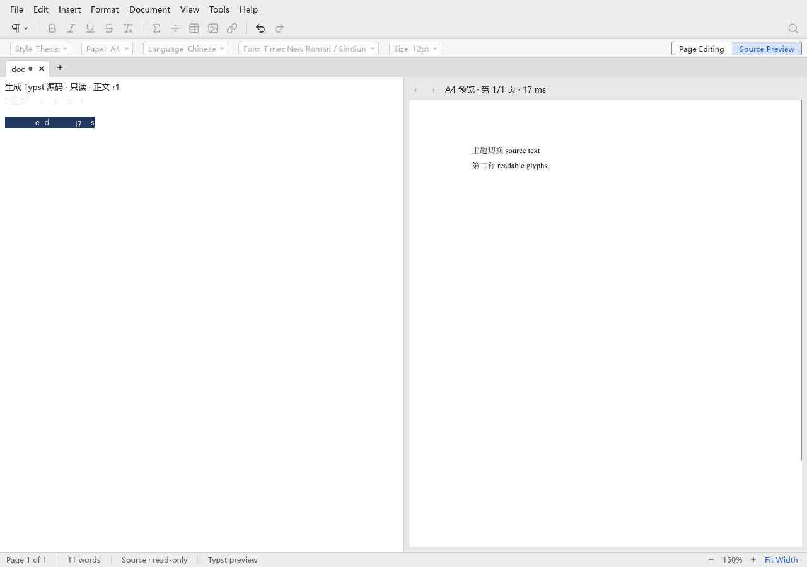
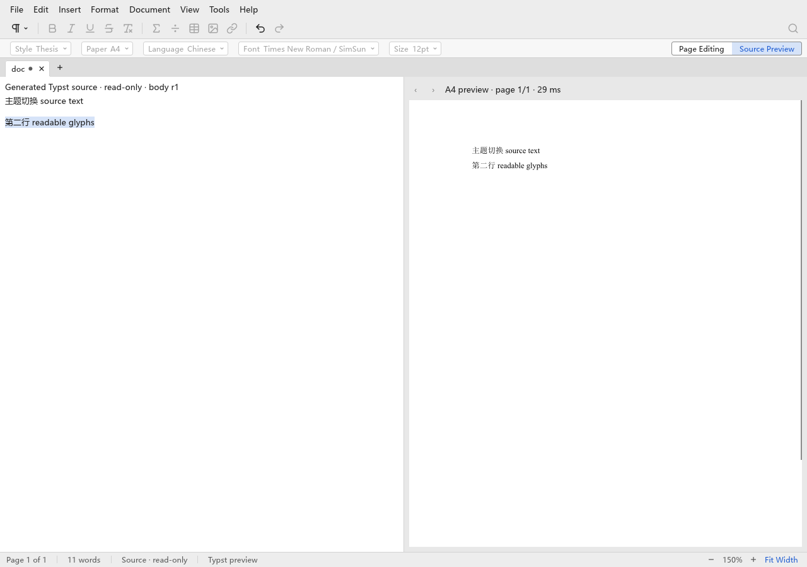
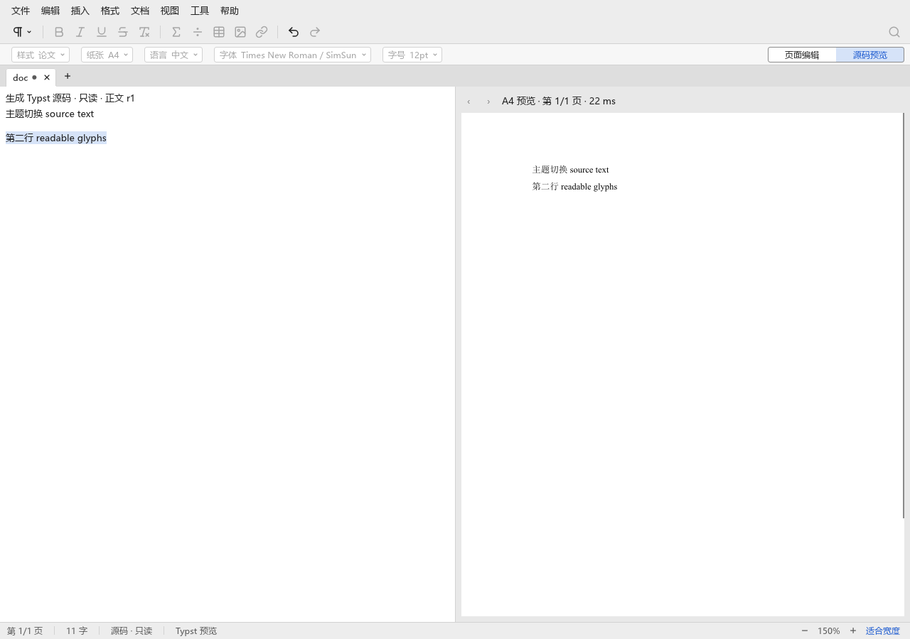

# T24：源码视图主题切换与标题本地化

## 问题与复现

在 `7de292e592e9c63d8953cac9d8bbfd58fc84cc38` 上，先切到深色主题，再进入源码预览，随后通过
“视图 → 主题 → 浅色”切换。左侧源码出现淡色、残缺字形；右侧 Typst A4 页面正常。
新增 `source-theme-check.py` 用同一正文比较该路径与浅色主题下全新打开的源码窗格。
正式复现与窗口门禁均经过 `window-checks.py` 的机器级锁与私有 Xvfb，没有访问桌面。

临时恢复上述基线的 `source_view.rs` 和 `paint.rs`，构建原实现后，运行：

```sh
python3 scripts/window-checks.py --only source-theme --locale en --out target/t24-source-theme-before
```

检查按预期失败：源码区域 `[8, 150, 620, 820]` 的 RGB 平均绝对差为 `1.0801214515657007`，
单通道差超过 8 的像素比例为 `0.00800409716125256`。固定门槛分别为 `0.1` 和 `0.001`。
原实现的主题切换单测也失败；基线文件在检查后恢复，未作为改动提交。



## 根因与修复

原 `SourceGalley` 只按快照身份与高亮范围缓存 `Arc<egui::Galley>`。Galley 持有已经烘焙的文字颜色与
字体图集 UV。egui 0.36 的深浅主题使用不同的文字覆盖率转换参数；`Fonts::begin_pass` 在参数变化后重建
字体图集并清空自己的 galley 缓存，但应用持有的 galley 不随之失效。

仅在应用缓存键里加入 `ctx.theme()` 仍无法修复：主题在当前帧切换时，现有 UI 的文字样式与字体图集会在后续
pass 才更新，按新主题名缓存的 galley 仍可能带旧颜色和旧图集 UV。实际窗口像素核对否决了该实现。

修复后，应用仅按快照、高亮范围和实际文字/高亮颜色缓存 `LayoutJob`，每帧通过 egui 的
`fonts.layout_job` 获取其当前字体图集对应的 galley。egui 正常 memoization 保留稳定帧的布局复用；
没有添加每帧强制 repaint，也没有在主题变化时滚动源码或重新提交 Typst 预览。
新增单测验证主题变化后颜色更新、稳定帧复用同一 galley，以及主题变化不被误判为高亮移动。

## 文字目录与门禁

源码标题、空槽/原串说明、预览编译中、预览失败与就绪标题迁入 zh-Hans/en Fluent 目录，使用
`revision`、`holes`、`raw`、`error`、`page`、`pages` 和 `ms` 命名参数。界面语言由绘制入口传入，
不缓存已翻译的标题。测试覆盖 en → zh-Hans → en、修订号、页码、时间、空槽/原串数量、编译与失败状态，
并确认文档快照身份不变。

原扫描器没有漏掉 `format!`：五个源码视图 CJK 模板都逐字存在白名单中，所以被允许通过。
删除这五条后，白名单由 63 条缩为 58 条。门禁增加格式化、raw format 和拼接模板的扫描自检，
并禁止已迁移的 `source_view*` 路径重新进入白名单。用临时格式化中文头部验证了两种失败：
未加白名单时报新增硬编码；尝试加回白名单时仍报已迁移视图必须走目录。临时文件及条目均已恢复。

## 验证

原始本地输出保存在本 slot 的 `target/t24-*` 下。最终 Rust 门禁结果：

| 命令 | 结果 |
| --- | --- |
| `cargo fmt --all -- --check` | PASS |
| `cargo clippy --locked --workspace --all-targets -- -D warnings` | PASS |
| `cargo test --locked --workspace` | PASS，447 通过，2 个既有手工计时测试忽略 |
| `RUSTDOCFLAGS='-D warnings' cargo doc --locked --workspace --no-deps` | PASS |
| `python3 scripts/check-rust-size.py` | PASS |
| `python3 scripts/check-doc-links.py` | PASS |
| `python3 scripts/check-ui-strings.py` | PASS，58 条存量白名单，含扫描自检 |
| `python3 scripts/check-layers.py` | PASS |
| `cargo deny --locked check licenses bans sources` | PASS，只有未命中既有许可允许项的提示 |
| `cargo build --locked -p scholium-app -p scholium-storage --bins` | PASS |
| `python3 scripts/window-checks.py --locale zh-Hans en --out target/t24-windows` | PASS，32/32（每种语言 16 项，含 source-theme 与 AT-SPI） |
| `python3 scripts/window-checks.py --only source-theme --locale zh-Hans en --out target/t24-source-theme-final` | PASS，最终脚本双语言补验 2/2 |

完整窗口队列每项一次通过；没有放宽任何现有像素阈值。
新增检查仅比较源码正文区域，排除预览耗时、菜单与滚动条；固定画布为 1280×900，X11 比例为 1。
PNG 解码使用 CI 已有的 ImageMagick，RGB8 差值统计使用 Python 标准库，无新增验证依赖。
最终双语言补验的平均 RGB 差与变化像素比例均为 `0`，与浅色主题全新打开的同一源码区域逐像素一致。
归档的修复后截图与 summary 均来自最终补验；原定 `0.1`、`0.001` 阈值保持不变。





Stock Typst 独立对照沿用工作流的两个生成命令与逐字节比较：

```sh
cargo run --locked -p scholium-typst --features editor --example typst-main-fork-check -- target/t24-fork-pixels
cargo run --locked --manifest-path spikes/typst-main-editor/reference/Cargo.toml --target-dir target/stock-reference -- target/t24-stock-pixels
python3 spikes/typst-main-editor/compare.py target/t24-fork-pixels target/t24-stock-pixels
```

`full`、`scripts`、`styles`、`heading` 四组尺寸与全部 RGBA 字节一致，`source_reads=0`。
本次只修改源码 UI 展示，没有改动 Typst 正文适配器、独立参考、字体资产或 stock 阈值。

## 范围

除任务列出的路径外，`typst_editor/paint.rs` 只增加了传递当前 locale 的一个参数；
`i18n/tests.rs` 只登记了五个新 key，保留目录“没有无人使用 key”的原有测试。
没有触及另一执行器拥有的 `scholium-typst/src/{fonts,style}.rs` 或字体资产。
早期新脚本调试曾直接在独立 `xvfb-run` 中执行；随后原实现失败对照、完整门禁和最终补验均使用带机器锁的正式 runner。
