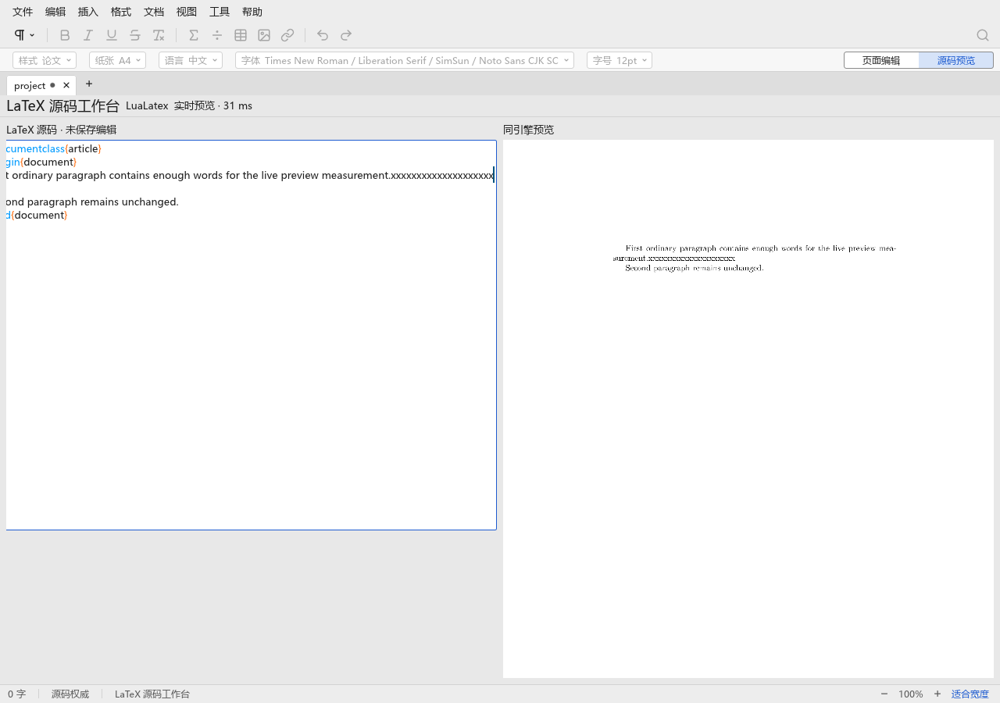
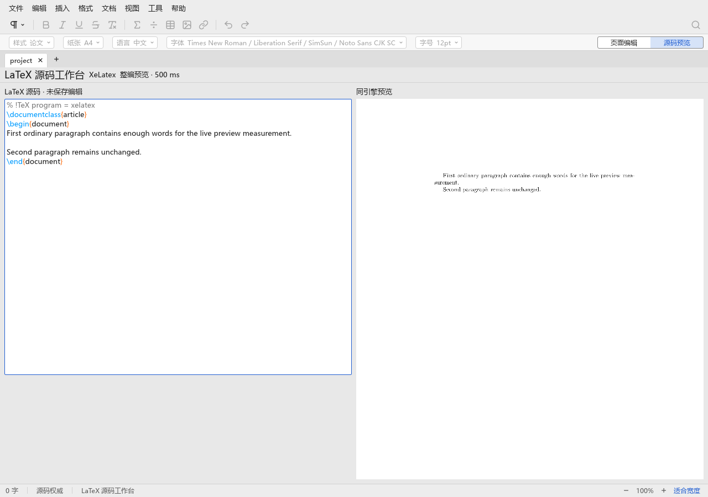
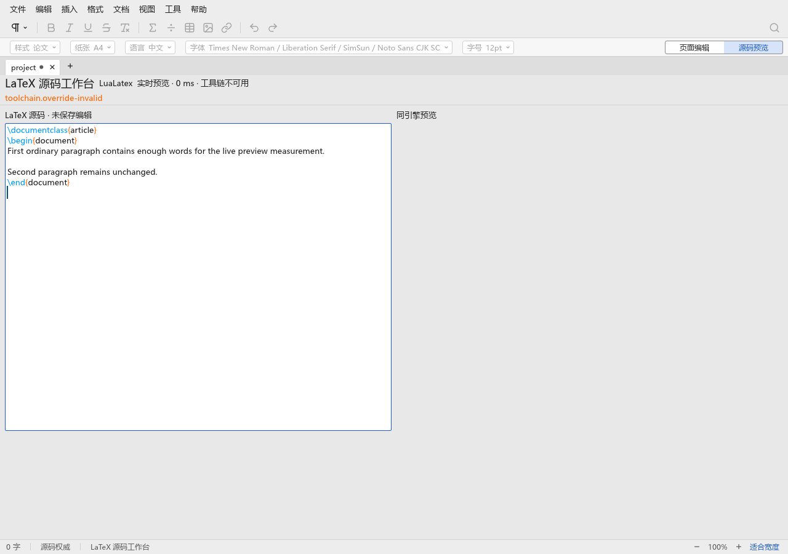
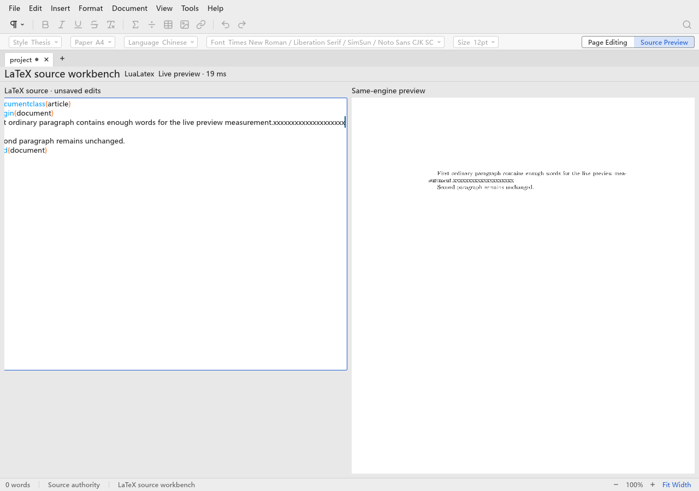

# rtex 随应用打包与共享工具链状态（T44）

任务在 `scholium-wt3`、`ation_ciger/feat/rtex-bundle` 上从 `origin/main` 的 `d11c0c6` 开始，
验证期间 `origin/main` 合入 PR #99（`c94bb32`，仅文档/参考图），已 fast-forward 整合并重跑非窗口门禁；
窗口重跑使用相同代码/二进制。没有修改另外两个 executor 的模型、诊断映射或 UI 实现。测试先行的缺接口失败记录在
[状态测试](evidence/rtex-bundle/red-toolchain.log)和[打包测试](evidence/rtex-bundle/red-bundle.log)。

## 问题与实现

旧 app worker 要求用户提供 rtex binary/support 两个环境变量，不能兑现“rtex 随应用安装”。新增
`scripts/bundle-rtex.py` 从现有 PIN 的完整 commit 构建仓库外缓存，固定 Rust/Cargo.lock/release，复用
T38 与相同 commit/lock hash 匹配的 E1 许可/来源证据，校验构建身份和复制前后 hash 后发布完整目录。
脚本收集了当前 host 的 120 个 normal/build 包的许可/notice 等文件；它不下载/打包 TeX Live，不移动 PIN。

本机三次执行脚本使用了同一增量缓存并得到相同二进制 hash：

- PIN：`531e2c6b32a09d33be58f6be1301fe8f793411cd`，CLI `rtex 0.0.6`。
- binary SHA-256：`a46184931e71cd0e95babd924b6fa452e78708dfafbfeb3cc01fc0441d7088ca`。
- 输出：`target/rtex-bundle/`，278 个受 hash 保护的文件，约 62 MiB。
- [首次构建](evidence/rtex-bundle/bundle-build.log)、[缓存重建](evidence/rtex-bundle/bundle-rebuild.log)、[最终脚本构建](evidence/rtex-bundle/bundle-final.log)。

`scholium-latex::toolchain` 增加可执行文件相对布局发现、PIN/manifest/文件完整性校验和一个后台缓存 detector。
缺包/坏包返回可本地化的 issue/action，不 panic；显式开发覆盖单独标出。六个版本命令并行、有 deadline 和输出预算，
bundle 校验有字节/项数及等待预算，整个状态检测最多等待 6 秒，文件系统查询也放在线程池。`cached` / `refresh` 供起始页、设置和空预览共享，未接入新 UI。
build 只增加只读的 font-cache marker 查询，app worker 最小替换旧的路径拼装以调用新发现入口。

本机 `kpsewhich` 只报告 kpathsea；检测从引擎输出补充发行版年份，另有回归测试。
[正常状态](evidence/rtex-bundle/status-installed.json)确认 bundle valid、无 override、TeX Live 2026 及五个工具版本；
[隐藏 PATH](evidence/rtex-bundle/status-hidden-path.json)仍报告有效 bundle，同时返回
`toolchain.tex-missing` / `toolchain.install-tex`，没有执行文档或错误降级。

## CI 取舍

每次 PR 的 workspace 测试使用假 bundle/版本程序验证布局、缺失、PIN 不匹配、文件篡改、symlink/路径拒绝、
挂起/输出超限、kpathsea 发行版识别以及缓存重检，无须 TeX。lint job 增加打包脚本的 Python 单元测试。
没有在常规 CI 构建真 rtex：它会额外编译独立 workspace 的 120 个依赖，且没有 TeX 的 runner 仍不能验收真实预览；
PIN 升级本已有独立的 E1/E2/E8 评审，T44 用本机真实构建/预览补充产物验证，重复外部构建的常规成本没有对应收益。
没有添加逐窗口 workflow 步骤；窗口仍由 `scripts/window-checks.py` 自动发现并使用机器级锁。

已有的 latex-view/project-latex 不可用窗口场景改用明确不存在的开发覆盖，使它们在已打包的开发机上仍确定性通过。
真实预览附加场景使用没有任何 `SCHOLIUM_RTEX_*` 的正常发现路径。

初轮为 53/54，project-native 启动即报 XOpenDisplayFailed；完整记录和失败日志均保留。
第二轮 36/54，多项私有 Xvfb 被 SIGKILL，见 windows-second.log。资源事件检查确认 cgroup 及父级 oom/oom_kill 都为 0。
进一步从 systemd journal 定位到机器上另一个无关任务按 comm 等于 Xvfb 扫描并向所有匹配进程发 SIGKILL，直接解释跨显示编号中断。
曾尝试的 -noreset/编号段更改没有解决全局按名杀进程，已撤回，不提交猜测性 runner 修复。
第三轮新增服务器日志放进要求空目录的夹具，导致启动前失败；发现后停止仅本轮进程树并保留 windows-isolated-aborted.log。
这是验证配置错误，不计通过。

最终验证仅在本 slot 的 target/t44-window-bin/ 复制系统 Xvfb 为 scholium-xserver，用 PATH 中 wrapper 调用相同字节服务器，
避开外部任务的 comm 匹配；未修改外部任务、未触碰桌面，机器锁和全部 UI 判定不变。CI 无此本机外部任务，无需提交 wrapper。
受保护的完整检查为 53/54，唯一失败是英文 project-native 在 SIGKILL 应用后重新打开时 XOpenDisplayFailed，
此次服务器没有被 SIGKILL。随后只在本地 wrapper 加 -noreset 以保持私有显示的连接状态，定向重跑两种语言的 project-native。
完整检查与定向重检分别报告，不把先前失败抹掉。
定向复验中英文均通过（2/2），所有 54 个场景均获得最终通过记录；见
[完整运行](evidence/rtex-bundle/windows-driver.log)与[定向复验](evidence/rtex-bundle/windows-project-native-recheck.log)。

## 验证

完整命令、退出码与耗时见 [gates.json](evidence/rtex-bundle/gates.json)；各命令完整日志在同目录。
整合 T43 后 workspace 测试为 672 passed、15 个既有原生测试 ignored，Python 打包合同测试 3 passed。
本次未修改 Typst fork/adapter，stock 比较不适用。

中文真实窗口在没有任何 `SCHOLIUM_RTEX_*` 变量时打开 LaTeX 项目并完成实时更新；同引擎 XeLaTeX 整编预览也成功。
[机器结果](evidence/rtex-bundle/native-window-zh-Hans.json)记录 live 为 DisplayList、XeLaTeX 为 FullCompilation。
20 次键入到实际 XGetImage 前台像素变化的 p50 83.3 ms、p95 106.2 ms（私有 Xvfb、software GL；不是后台编译耗时，
不作为跨机器性能比较），suspend 差小于 1 秒。首次预览使用默认路径自动准备字体缓存；最终状态重检的 `font_cache_warm` 为 true。

英文同一路径也完成 LuaLaTeX、XeLaTeX 与 20 次实际像素更新验证，见
[机器结果](evidence/rtex-bundle/native-window-en.json)；最终结果 p50 53.0 ms、p95 56.4 ms。
这些窗口观察处于同一机器不同负载阶段，不用两者差值推断语言对性能的影响。

## 共享文件与边界

唯一改动的 app 文件是 `crates/scholium-app/src/latex_workspace/worker.rs`：删除旧的环境变量/缓存拼装，
调用 `toolchain::discover()` 和共享缓存路径，不改 UI、诊断、输入或绘制。另最小修改 latex `lib.rs` 导出新模块，
`Cargo.toml`/`Cargo.lock` 加入工作区已锁定的 sha2 依赖边；CI 仅加 Python 合同测试。窗口 runner 无最终改动。

本次定义了安装包资源布局并产出可复制的 bundle；跨平台安装器和 macOS/Windows 沙箱不在此任务验收范围。
消息键/参数接口已经提供，后续起始页/设置 UI 批次负责本地化目录和“重新检测”的交互；当前没有新增 UI。

## 交付与 PR-body 材料

问题：旧启动配置要求用户指定 rtex 路径，应用无法自行发现完整且匹配 PIN 的工具链；缺少共享状态检测接口。

改动：精确 PIN 的仓库外 locked/cached bundle 构建、完整许可与 manifest；安装/开发布局发现和 hash/PIN 校验；
后台、有界、可刷新缓存的工具链状态及消息 ID/参数；最小 app 启动接线；假 bundle CI 合同测试；ADR 与模块规范更新。

验证：全部非窗口门禁通过，整合后 workspace 672 passed/15 ignored；打包 Python 3 passed；真 bundle 三次构建 hash 相同；
无 rtex 覆盖变量的中英 LuaLaTeX 实时和 XeLaTeX 整编预览通过，隐藏 PATH 返回缺少 TeX 的本地化问题。
窗口完整运行 53/54，显示重连环境修正后定向复验 2/2，最终 54 个场景均通过。外部全局杀 Xvfb 的干扰及本地解决方式保留证据。

待办：没有 T44 必须项未完成。后续 UI 批次消费状态消息键并装配“重新检测”；跨平台安装器与 macOS/Windows 沙箱另行验收。
CI 不重复构建真 rtex，成本/价值取舍见上；不会创建 PR，由协调者审阅并拟稿。

提交前 origin/main 再前移至 T43 的 80722fd（诊断 pipeline）。先以 fbd53f1 签名保存已验收的 T44 实现，
再以签名 merge 整合。冲突仅在 latex lib.rs 导出位置及 latex.md 末尾：同时保留 log/toolchain 导出和两份规范章节，
其余诊断文件原样保留。整合后全部非窗口门禁重新通过（672 passed、15 ignored），另重跑完整中英文窗口验收。

整合后完整中英文窗口检查 **54/54 全部通过**，无定向复验需求；最终机器结果、截图已更新为此轮。
完整记录见 [windows-integrated.log](evidence/rtex-bundle/windows-integrated.log)。所有必需门禁完成。
