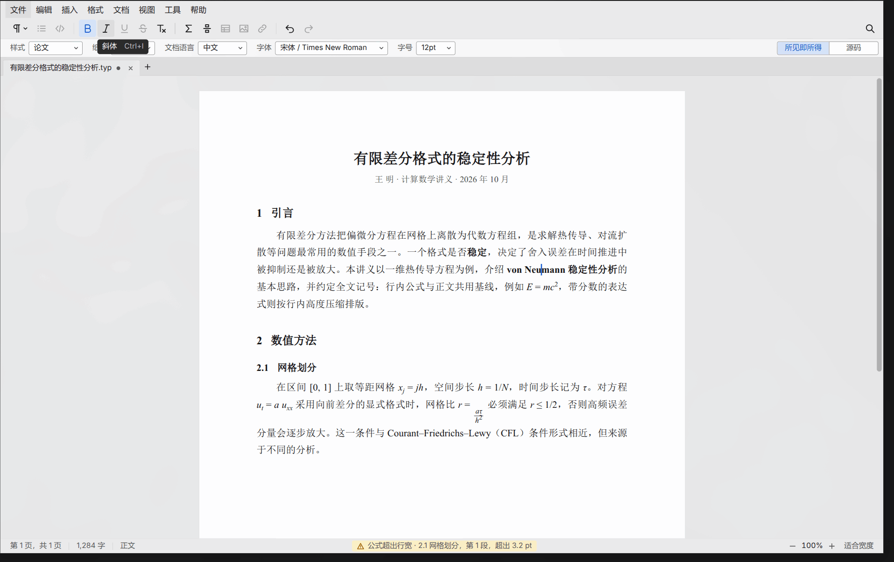
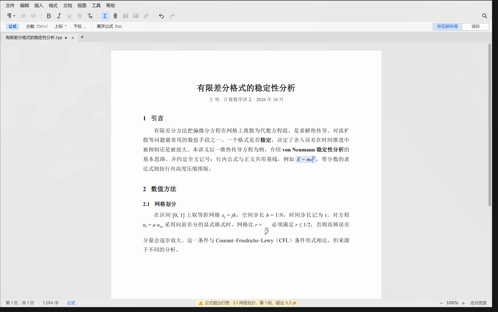
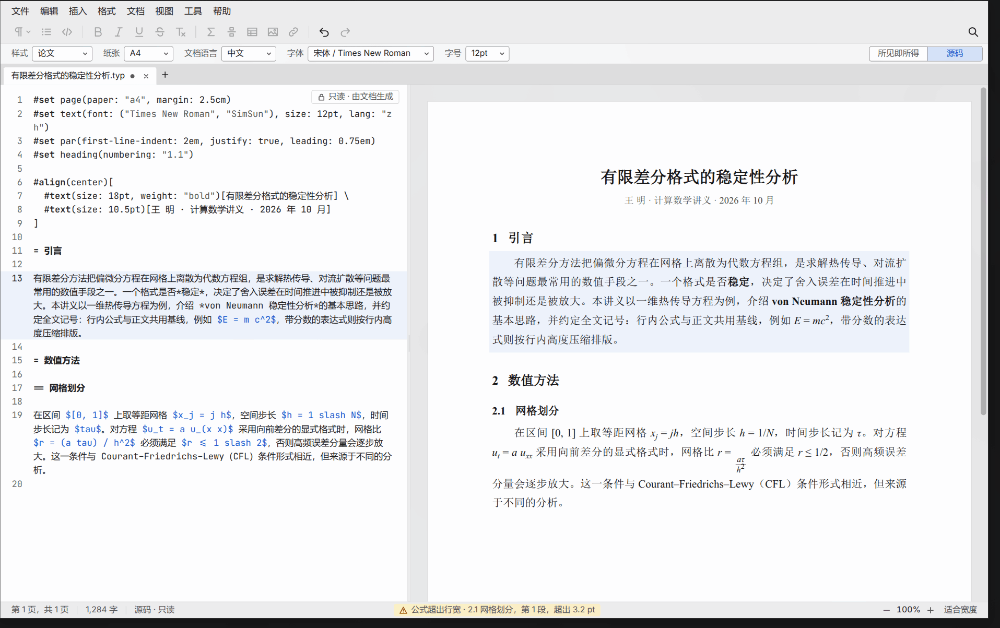
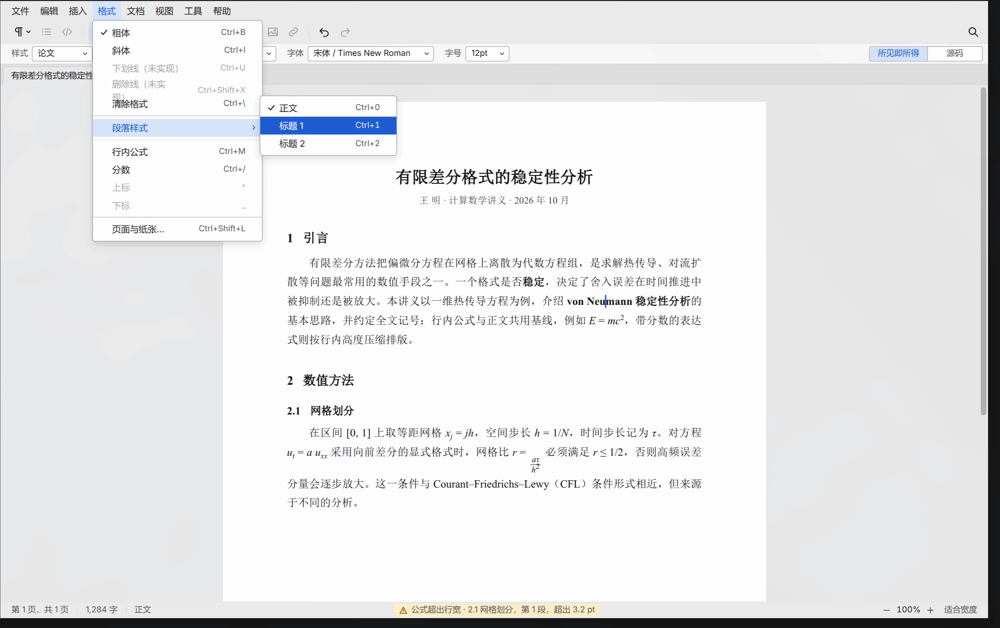
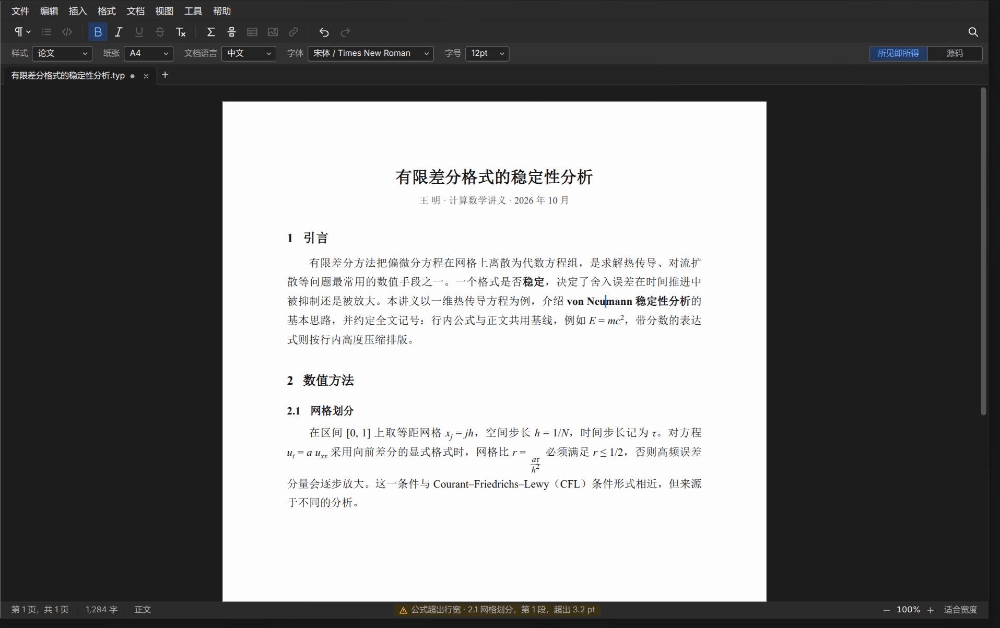
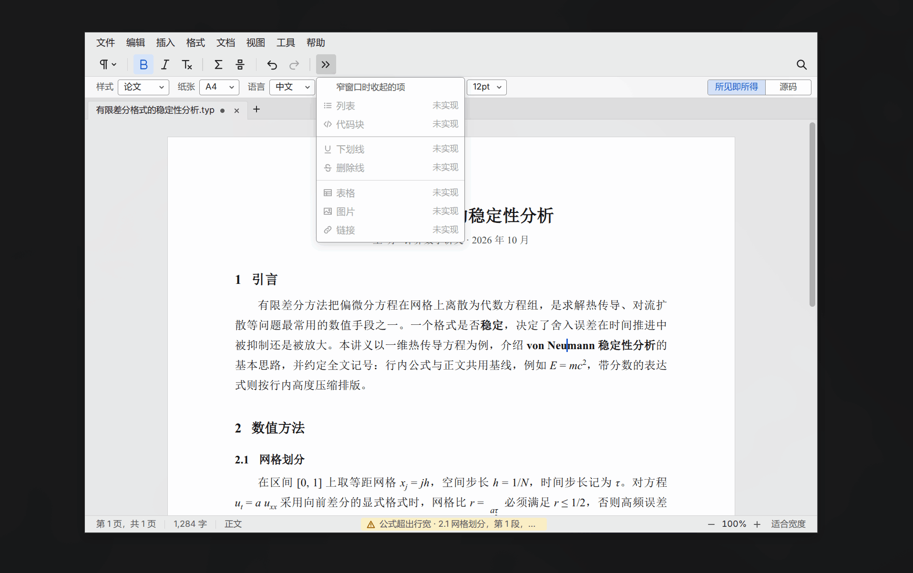
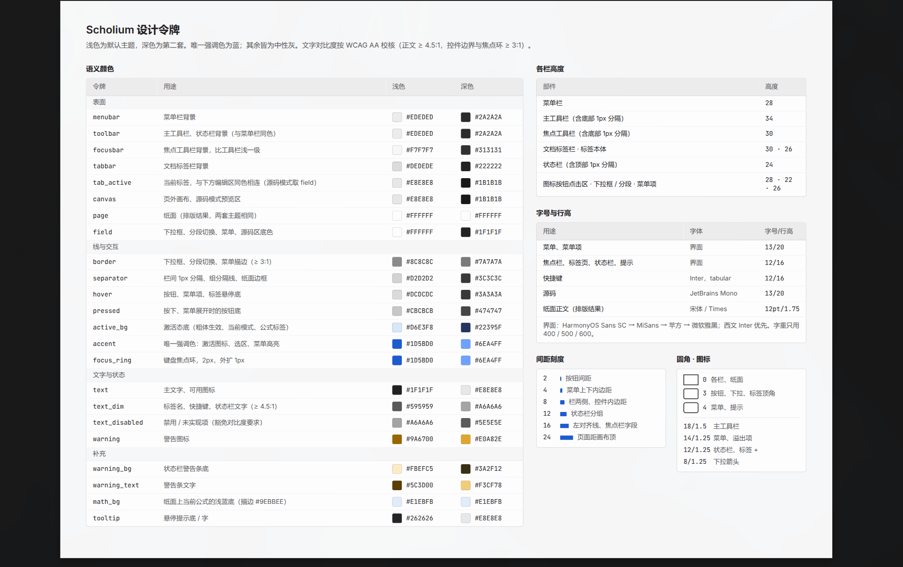
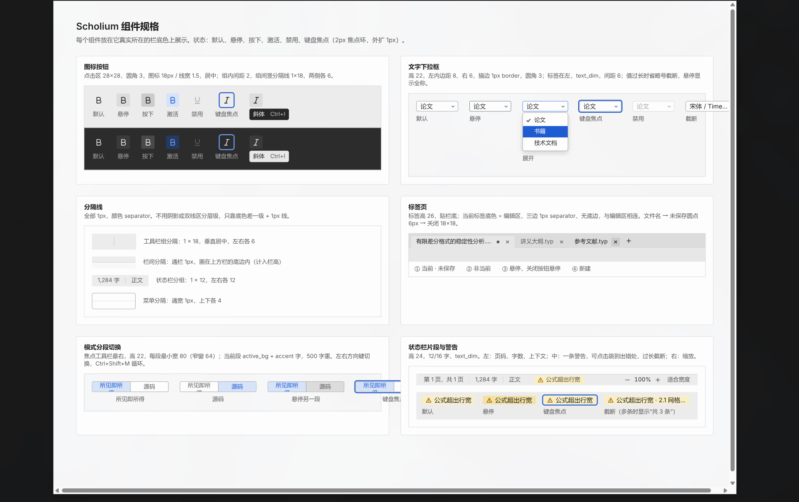

# P1 排版工作区规划

本页规划[阶段 1](ROADMAP.md#阶段-1两个内核的打开编辑预览保存输出闭环)的应用壳与编辑入口。
产品定位为科学排版软件，服务论文、书籍、技术文档和研究写作；P1 的基础文本、数学与文件闭环是实现子集，
不能据此把产品收窄成笔记软件。本页作为后续实施与评审的布局基准，不要求逐像素复刻，也不表示对应功能已经实现或通过验收。
正式界面沿用 Rust / egui 原生路线；设计稿仅表达布局、令牌与操作关系，不作为应用 UI 技术验证依赖。

## 如何参照执行

开工前先读[体验规范的工作区原则](../EXPERIENCE.md#工作区组织)，再按本页安排布局与操作入口。
原则约束交互关系，参考图与令牌表帮助理解空间关系和视觉层级，具体控件服从原生平台、可访问性和真实编辑需要。

| 层级 | 执行方式 |
|---|---|
| 必须保持的原则 | 科学排版定位；页面编辑是单一编辑面；源码与预览同等重要；文件操作归属文件菜单；正文优先；权威模型及构建状态不含混 |
| 默认起点 | 自上而下为菜单栏、主工具栏、焦点工具栏、文档标签栏、编辑区、状态栏；源码与预览约 1:1；文件导航和诊断默认收起；菜单、工具栏、焦点工具栏与快捷键调用同一命令 |
| 可自行优化的细节 | 字体回退、图标、几像素间距、菜单分组顺序、缩放策略、窄窗口折叠方式；可因平台和文档类型调整 |
| 不应照搬的示例 | 示例文稿、作者、菜单中尚未交付的能力、设计稿中的纸面排版细节（纸面由 Typst 实际排版）、截图的滚动与裁切 |

日常细节调整不另设确认门槛：实现者应根据可读性、空间利用、键盘/IME 与无障碍表现作判断。
改变主要区域关系或工作方式时，同一变更先更新对应规范与本页，并在评审说明中给出原因及前后界面对照；
不必为颜色或几像素差异修改整套规划。阶段范围仍由路线图约束，不能因为图上有某个入口就提前扩展 P1。

## 布局变更：由 Ribbon 改为三栏工具区

早期规划采用 Office 式 Ribbon。实际实现后，Ribbon 约占 170 逻辑像素，分组空旷、层级混乱，
与科学排版软件的使用方式不符；[路线图](ROADMAP.md)阶段 1 本就写明“标准菜单与紧凑工具栏”。
新布局参考 Mogan 的菜单栏、图标栏与随焦点变化的上下文栏三层结构（只借鉴结构，不复用其实现，
见[开发规范](../../AGENT.md)第 1 条），以及 [ArtCraft / PhotoCraft / WordCraft 借鉴计划](ARTCRAFT_REFERENCE.md)中的设计令牌做法。
顶部四栏合计 122 逻辑像素，比 Ribbon 节省约 50 像素且每栏职责单一。
本页的设计稿（2026-10-14 由 Claude Design 按本项目需求生成）替代此前的工作区草图。

## 2026-11-03 修订：界面精修

[全界面截图审查](../log/2026-11-03-ui-audit.md)发现：外壳没有按项目语言装配，大量入口灰显，开发信息外露，
对话框简陋，诊断收不到 LaTeX 错误。用户确认的方向是：以 2026-10-14 设计稿为底精修，做适度的现代化，增加起始页；
观感参考 Zed / JetBrains 新 UI 与 Typora / Obsidian：克制、扁平、信息密度高、正文为主。
不使用卡片式面板、胶囊标签、装饰性阴影、渐变或大面积强调色。新设计稿在 `assets/p1-ui/2026-11/`，
与 10-14 的图同属布局参考，不是像素验收样本。

本修订替换以下旧条款，正文对应位置已同步改写：

| 旧条款 | 改为 |
|---|---|
| 未实现项在菜单、工具栏、溢出菜单中灰显并保留位置 | 未实现的命令不出现；只有“当前不可用但已实现”的命令灰显（例如没有可重做的动作） |
| 已确认决策 3：焦点工具栏显示禁用的文档属性下拉框 | 文档属性可编辑前不出现在焦点栏；Typst 正文焦点栏只放实际可用的操作 |
| 令牌中 border `#8C8C8C`、三层工具栏三种底色 | 边框调浅，菜单栏、主工具栏、焦点栏同一底色，层次靠间距与 1px 分隔线 |
| 分隔线一律不用阴影 | 各栏仍不用阴影；弹出层与对话框用一层很浅的阴影把它们和下层分开 |

### 外壳按项目语言装配

工作区按项目语言决定工具栏、焦点栏、菜单和状态栏的内容。命令注册表为每条命令声明适用的内核，
不适用的命令在该项目里不出现，而不是灰显。

| 区域 | Typst 原生项目 | `.typ` 源码项目 | LaTeX 项目 |
|---|---|---|---|
| 主工具栏 | 段落样式、粗体斜体、公式结构、撤销重做 | 撤销重做 | 段落样式（插入 `\section` 等）、章节、环境、公式、引用、图片、表格、撤销重做、整编 |
| 焦点栏（左） | 正文：可用的正文操作；公式：数学结构与快捷键 | 光标位置面包屑 | 光标位置面包屑，如 `main.tex › 1 引言 › equation`，点击任一级跳转；进入公式时显示数学结构操作 |
| 焦点栏（右） | 页面编辑 / 源码预览 | 同左 | 同左。L3 之前点“页面编辑”显示整页预览，并说明页面公式编辑在阶段 3 提供 |
| 状态栏 | 页码、字数、上下文、问题计数、Typst 同步状态、缩放 | 行列、问题计数、Typst 同步状态、缩放 | 行列、字数、问题计数、引擎与预览状态（如“LuaLaTeX · 实时 52 ms”）、缩放 |

主文件、引擎、参考文献工具等很少改动的项目参数放在“文档 → 项目设置…”，不占焦点栏；
状态栏的引擎状态点击后打开项目设置。

### 起始页

没有打开项目时显示起始页，见 `2026-11/start-page.png`：应用名与一句定位；“开始”（新建项目、打开、从旧版本导入，各带快捷键）、
“最近”（项目名、路径、语言）、“环境”（TeX Live 与随应用安装的 rtex 是否就绪，缺失时给出安装说明与“重新检测”）三组纯文字列表。
悬停才出现底色，不用卡片或插图。项目被另一进程打开时，在起始页顶部说明是哪个项目，并提供“重试”。

### 源码编辑器与预览窗格

两种语言共用的源码编辑器占满窗格高度，带行号、当前行高亮和行号旁的问题标记；高亮与诊断由内核提供。
源码与预览之间的分隔条可拖动、可用键盘调整，双击恢复等宽。预览窗格中纸面居中，状态栏缩放与“适合宽度”作用于预览，
缺工具链或构建失败时显示居中说明和可执行的操作，保留上次成功的结果并标明它对应的版本。
`.typ` 源码项目同样是源码加 Typst 预览两栏，打开后焦点在源码编辑器。
生成的 Typst 源码保持只读，补上行号、高亮与当前块高亮，标题只写“由文档生成 · 只读”。

### 问题面板

问题面板取代现有诊断面板，做法与 IDE 一致，见 `2026-11/latex-workbench.png`：

- 一行一个问题：严重级别图标（错误为圆点、警告为三角、信息为圆圈）、消息、`行:列`；按文件分组，组标题显示文件名与条数。
- 单击或回车跳到源码对应位置并选中出错范围；Typst 原生项目跳到页面上的对应节点。F8 / Shift+F8 前后切换（经键位表绑定）。
- 面板顶部有“问题”与“构建输出”两页，右侧显示错误与警告计数。状态栏常驻同样的计数，点击打开面板。
- 后端、revision、缓存命中、布局耗时等开发信息不进入问题面板；只在 `SCHOLIUM_EDITOR_AUDIT` 输出中保留。

### 对话框

所有对话框共用一套规格：标题栏左侧为标题、右侧为关闭按钮；内容区 18 px 内边距；底部按钮靠右，主按钮为强调色实心，
其余为描边按钮。Enter 触发主按钮，Esc 等于取消。字段错误在字段下方就地显示。对话框宽度不超过窗口宽度减 32 px，窄窗口内可滚动。

- **新建项目**（`2026-11/new-project.png`）：语言单选（LaTeX 默认，附一句说明）、模板、名称、位置（带“浏览…”），下方提示将创建的路径；
  引擎有默认值，以后在项目设置中更改。
- **打开**：直接调用系统文件选择器，可以选文件夹或 `.tex`/`.typ` 文件；多入口目录在随后的小对话框中选择主文件。
  “从旧版本导入”放在起始页和文件菜单，不放在打开对话框里。
- **项目设置**（`2026-11/project-settings.png`）：主文件、引擎（说明实时与整编的区别）、参考文献工具；项目语言只读显示。
- **外部修改冲突**（`2026-11/external-conflict.png`）：标题写明哪个文件、什么时候被改；正文一句说明为什么没保存，一句说明各操作的后果；
  操作为“查看差异”（左侧）以及“取消 / 重新载入 / 另存为…”，主按钮是两边都不丢内容的“另存为…”。

### 命令框与悬停提示

`\` 命令框贴在光标下方，候选行显示符号、命令名和类别，底部一行键盘提示，见 `2026-11/typst-math-focus.png`。
悬停提示只在能补充信息时出现，例如快捷键、不可用的原因；不重复按钮上已有的文字。

### 先定接口、按顺序实现的部分

- **文件选择器**：`FilePicker` 接口有两种实现，系统选择器（Linux 走 xdg-desktop-portal）和应用内路径输入回退；
  系统选择器的依赖评估与接入排在对话框批次之后，接口先行。
- **诊断**：统一的诊断条目包含严重级别、来源内核、资源路径、行列范围、消息与可选代码。问题面板只消费这个结构；
  rtex 诊断与 Typst 编译诊断先接入，TeX 日志解析（`latex.md` 的 `log.rs`）作为后续来源接入同一结构。
- **工具链状态**：rtex 版本（随应用打包）、TeX Live 与可用引擎，由起始页、项目设置和预览空状态共用。

### 实施顺序

每批交付都附中英文、浅深色的前后对照截图，并跑完 window checks。

1. 令牌与基础组件（按钮、输入框、下拉框、分段切换、弹出层、对话框框架、Esc/Enter 规则），命令按内核声明适用范围，
   移除未实现入口与开发信息。
2. 起始页与对话框（新建、打开、项目设置、外部修改冲突、项目被锁、旧会话迁移），`FilePicker` 接口与应用内回退。
3. 共享源码编辑器与预览窗格：LaTeX 工作区按本节重排、`.typ` 源码项目加预览、rtex 随应用打包、工具链状态。
4. 问题面板与诊断结构，接通 LaTeX 诊断（审查发现 1），跳转与 F8。
5. 焦点栏面包屑、命令框与状态栏，窄窗口与深色主题复核。

## 参考图

设计稿保存在仓库内，来源与维护方式见[素材说明](assets/p1-ui/README.md)。页面内正文由 Typst 实际排版，
设计稿中的纸面内容只是示意；以下所有图都不作为像素验收样本。

### 页面编辑：光标在正文

### 页面编辑：光标在公式

### 源码：源码与排版结果并重

### 菜单展开

### 深色主题与窄窗口

### 设计令牌与组件规格

## 两种工作方式

### 页面编辑

页面中的排版内容就是编辑对象：光标、选区、中文输入、结构数学和焦点都在这里工作。
即时排版直接更新该编辑面，**不在右侧重复显示预览**，也不为独立预览预留空栏。
默认收起文件导航和诊断；页面视口使用标签栏以下、状态栏以上的全部空间。
连续编辑、分页显示与最终排版检查是视图职责，不把排版软件等同于一个带预览的小型笔记页。

正文纸张边距由排版样式决定，工作区外边距保持紧凑。编辑区按缩放与窗口宽度显示内容，
不能靠缩小正文和放大空白来制造“简洁”。纸面在深浅两套主题中都是白色排版结果。
LaTeX 发布目标的最终检查由“文档”菜单按需打开，不占据日常页面编辑布局。

### 源码与预览

主工作区分为左右两个同等重要的窗格：左侧源码，右侧排版结果，默认 **50% / 50%**。
比例按扣除文件导航后的剩余宽度计算；分隔条可拖动、用键盘调整并恢复等宽。
源码窗格显示语言、文件或生成视图来源（生成视图标“只读 · 由文档生成”）；预览窗格显示实际后端、同步/过期和构建状态。
预览支持缩放、适合宽度与点击定位，不使用固定 220–300 像素的小型缩略图代替工作预览。

同一文档切换工作方式不改变权威模型：

- 原生项目的源码为生成视图；显式开始编辑后成为独立草稿，检查并应用后才修改正文。
- 外部 `.tex` / `.typ` 项目直接编辑权威源文件；语法错误仍能保存，使用对应原生后端构建。
- 切换可查看的生成方言不等于切换可写语言；有草稿时须先提交、保存或显式处置，再进入另一语言写入。
- 草稿未应用或构建失败时，保留上次成功排版并明确它对应的内容版本，不伪装当前草稿已经生效。

## 区域与空间分配

窗口标题栏与最小化、最大化、关闭按钮由操作系统提供，应用不自绘；文档名与修改标记显示在系统标题中。

| 区域 | 高度（逻辑像素） | 布局与职责 |
|---|---|---|
| 菜单栏 | 28 | 文件 编辑 插入 格式 文档 视图 工具 帮助；纯文字、左对齐，样式朴素如原生菜单。菜单树由命令注册表生成 |
| 主工具栏 | 36 | 纯单色线性图标，按组用竖分隔线隔开；每个图标有悬停提示“名称 + 快捷键”；当前格式生效时为激活态；只放当前内核已实现的命令（2026-11-03 修订）；最右侧为命令搜索 |
| 焦点工具栏 | 32（含底部 1px 分隔） | 内容随项目语言与光标所在节点变化，见“2026-11-03 修订”的装配表：Typst 正文为可用的正文操作，公式中为“公式”标记与结构操作；源码项目为光标位置面包屑。最右侧固定为“页面编辑 / 源码预览”分段切换 |
| 文档标签栏 | 30（标签本体 26） | 位于三栏工具区下方、编辑区上方；每个文档一个标签（文件名、未保存圆点、关闭），当前标签与编辑区同色相连，末尾“+”；只有一个文档时也显示 |
| 主编辑工作区 | 余下全部 | 页面编辑为居中 A4 页面与浅灰画布；源码模式为等宽双窗格，二者互斥 |
| 可选辅助面板 | — | 文件导航与问题面板由“视图”菜单展开；问题面板也可由状态栏的问题计数展开；均默认不挤占正文 |
| 状态栏 | 24（含顶部 1px 分隔） | 按项目语言装配（见修订节）：左为位置、字数与上下文；右为问题计数（点击打开问题面板）、内核与预览状态（如“Typst · 已同步”“LuaLaTeX · 实时 52 ms”，点击打开项目设置）、缩放与适合宽度。revision 等开发信息只进入 AUDIT 输出 |

窄窗口（如 1024×700）时，主工具栏放不下的按钮按组收进“»”溢出菜单，焦点工具栏下拉框收窄并截断，
菜单栏、模式切换与命令搜索始终可见。辅助导航展开时建议约 166–220 逻辑像素并允许调整，源码与预览继续平分余下宽度。
正式桌面应依据可读字号选择保留分屏或切换单窗格，不能默认把预览缩成缩略图。
这些尺寸需要在原生字体、DPI、输入法与辅助功能环境下检验；不可牺牲文字或点击目标可用性。

## 菜单、工具栏与焦点工具栏组织

菜单、主工具栏、焦点工具栏、溢出菜单、命令搜索与快捷键都来自同一命令注册表（[借鉴计划](ARTCRAFT_REFERENCE.md)采纳项 1），
启用、选中状态与不可用原因由命令判定统一给出；不同入口不得各自维护一份命令或快捷键。

- **文件**：新建、打开、最近打开、保存、另存为、导出、关闭。打印入口属于整体产品规划，单独确定交付阶段。
- **编辑**：撤销、重做、剪切、复制、粘贴、查找与替换。
- **插入**：行内/独立公式、分数、根式、上下标与定界符；以后扩展表格、图片、链接、引用等文档对象。
- **格式**：粗体、斜体、下划线、删除线、清除格式；段落样式子菜单（正文、标题 1、标题 2）。
- **文档**：样式与模板、页面与纸张、文档语言、正文字体与字号、最终排版检查；能力按阶段开放。
- **视图**：工作方式、文件导航、诊断、缩放与分屏、主题；改变显示不应修改文档内容。
- **工具**：命令搜索、偏好设置；以后扩展格式转换等工具。
- **帮助**：快捷键、命令说明与应用信息。

主工具栏分组：段落样式与结构（列表、代码块）｜文字格式（粗体、斜体、下划线、删除线、清除格式）｜
插入（行内公式、分数、表格、图片、链接）｜历史（撤销、重做）｜命令搜索（最右）。

未实现的能力不出现在菜单、工具栏与溢出菜单中；已实现但此刻不可用的命令置灰，原因放在悬停提示里，不写进标签文字（2026-11-03 修订）；
只读生成源码、组合输入等状态不能因切换入口而绕过写入门禁。
剪贴板和格式命令须保留页面语义光标/选区，完成后继续在页面输入，不引入第二个正文编辑区。

导出从文件菜单进入模态流程，不常驻按钮卡片；兼容报告列出降级、阻断、源位置和依赖。
输出锁定 revision，未解决问题阻止正式输出；保存写当前项目，另存为创建独立项目，导出生成副本。
恢复在重新打开异常会话时触发，显示可恢复正文动作与独立草稿，不做成一个日常工作标签。
外部文件冲突按事件触发比较与解决界面，不静默覆盖磁盘内容或本地修改。

## 设计令牌

浅色为默认主题，深色为第二套。唯一强调色为蓝，其余为中性灰；文字对比度按 WCAG AA
（正文 ≥ 4.5:1，控件边界与焦点环 ≥ 3:1）。实现时所有界面颜色、圆角与尺寸都从令牌读取，控件内不得硬编码颜色。

| 令牌 | 用途 | 浅色 | 深色 |
|---|---|---|---|
| chrome | 菜单栏、主工具栏、焦点栏与状态栏的统一底色 | `#F2F2F3` | `#2A2A2A` |
| tabbar | 文档标签栏背景 | `#EAEAEC` | `#222222` |
| tab_active | 当前标签，与下方编辑区同色相连（源码模式取 field） | `#E6E6E8` | `#1B1B1B` |
| canvas | 页外画布、源码模式预览区 | `#E6E6E8` | `#1B1B1B` |
| page | 纸面（排版结果，两套主题相同） | `#FFFFFF` | `#FFFFFF` |
| field | 下拉框、分段切换、菜单、源码区底色 | `#FFFFFF` | `#1F1F1F` |
| border | 输入框、下拉框、分段切换描边（对比度仍须 ≥ 3:1 时改用 focus_ring 标示焦点） | `#CFCFD4` | `#5A5A60` |
| separator | 栏间 1px 分隔、组分隔线、纸面边框 | `#E0E0E3` | `#3C3C3C` |
| hover | 按钮、菜单项、标签、列表行悬停底 | `#E4E4E7` | `#3A3A3A` |
| pressed | 按下、菜单展开时的按钮底 | `#D8D8DC` | `#474747` |
| active_bg | 激活态底（格式生效、当前模式、公式标签、选中的问题行） | `#DCE6F8` | `#22395F` |
| accent | 唯一强调色：激活图标、选区、菜单高亮 | `#1D5BD0` | `#6EA4FF` |
| focus_ring | 键盘焦点环（2px，外扩 1px） | `#1D5BD0` | `#6EA4FF` |
| text | 主文字、可用图标 | `#1F1F1F` | `#E8E8E8` |
| text_dim | 标签名、快捷键、状态栏文字 | `#5C5C63` | `#A6A6A6` |
| text_faint | 路径、行列号、次要说明 | `#8E8E95` | `#7E7E84` |
| error | 错误图标与行号标记 | `#C4311F` | `#FF7A6B` |
| text_disabled | 禁用与未实现项 | `#A6A6A6` | `#5E5E5E` |
| warning | 警告图标 | `#9A6700` | `#E0A82E` |
| warning_bg | 状态栏警告底 | `#FBEFC5` | `#3A2F12` |
| warning_text | 警告文字 | `#5C3D00` | `#F3CF78` |
| math_bg | 纸面上当前公式的浅蓝底（描边 `#9EBBEE`） | `#E1EBFB` | `#E1EBFB` |
| tooltip | 悬停提示底（字色取对侧主题 text） | `#262626` | `#E8E8E8` |

| 尺寸类 | 取值 |
|---|---|
| 栏高 | 菜单栏 28；主工具栏 36；焦点工具栏 32；标签栏 30（标签 26）；状态栏 24；问题面板默认 180，可拖动 |
| 控件高 | 图标按钮点击区 28×28；下拉框与分段切换 22；菜单项 26 |
| 字号/行高 | 菜单与菜单项 13/20；焦点栏、标签、状态栏、提示 12/16；快捷键 Inter 等宽数字 12/16；源码 JetBrains Mono 13/20 |
| 间距刻度 | 2 按钮间距；4 菜单上下内边距；8 栏两侧与控件内边距；12 状态栏分组；16 左对齐线与焦点栏字段；24 页面距画布顶 |
| 圆角 | 0 各栏与纸面；4 按钮、输入框、下拉框、标签顶角；6 菜单、提示与弹出层；8 对话框 |
| 阴影 | 各栏、纸面与面板不用阴影；弹出层 `0 4px 14px` 10% 黑加 1px 6% 描边；对话框 `0 10px 30px` 18% 黑加 1px 8% 描边 |
| 图标 | 主工具栏 18 / 线宽 1.5；菜单与溢出项 14 / 1.25；状态栏与标签“+” 12 / 1.25；下拉箭头 8 / 1.25 |

界面字体：中文按 HarmonyOS Sans SC → MiSans → 苹方 → 微软雅黑回退，西文优先 Inter，等宽 JetBrains Mono；
字重只用 400 / 500 / 600。Windows 与 macOS 使用系统中文字体；在 Linux 随程序打包中文界面字体前，
须按许可证政策审查其许可（HarmonyOS Sans、MiSans 为各自的免费商用许可，不是 OFL）。纸面正文是排版结果，不属于界面字体。

## 组件规格

| 组件 | 规格 |
|---|---|
| 图标按钮 | 点击区 28×28，圆角 3，图标居中；组内间距 2，组间竖分隔线 1×18、两侧各 6；状态：默认、悬停（hover）、按下（pressed）、激活（active_bg + accent 图标）、禁用（text_disabled）、键盘焦点（focus_ring）；悬停提示“名称 + 快捷键” |
| 文字下拉框 | 高 22，左内边距 8、右 6，1px border，圆角 3；标签在左（text_dim，间距 6）；值过长以省略号截断，悬停显示全称；展开列表当前项带勾选 |
| 分隔线 | 一律 1px separator；栏间分隔画在上方栏底边内（计入栏高）；状态栏分组 1×12、两侧各 12；菜单分隔通宽、上下各 4。各栏之间不用阴影或双线区分层级 |
| 按钮 | 高 28，圆角 4，左右内边距 14；主按钮 accent 实心白字，其余为 field 底加 border 描边；对话框底部靠右排列，主按钮在最右 |
| 输入框 | 高 28，圆角 4，1px border；焦点时 border 与外圈 1px 均为 focus_ring；错误说明显示在框下方 |
| 问题行 | 高 26；严重级别图标、消息、行:列（text_faint）；按文件分组，组标题 24 高；选中行 active_bg |
| 标签页 | 高 26，贴栏底；当前标签底色等于编辑区，三边 1px separator、无底边；文件名 → 未保存圆点 6 → 关闭按钮 18×18 |
| 模式分段切换 | 焦点工具栏最右，高 22；当前段 active_bg + accent 字、字重 500；左右方向键切换 |
| 状态栏片段与警告 | 高 24，12/16，text_dim；警告用 warning_bg 底与 warning_text 字，可聚焦、可点击跳转，过长截断，多条时显示“共 N 条” |

## 实施时要修正的设计稿问题

- “格式”菜单中“删除线（未实现）”换行并压住下一项：菜单宽度按最长标签计算，标签不写“（未实现）”，原因放悬停提示。
- 模式分段切换每段按标签文字测量宽度，不小于 96，保证“页面编辑 / Page Editing”和“源码预览 / Source Preview”在两种语言下均为单行。
- “页面与纸张…”出现在“格式”菜单：归入“文档”菜单。
- 设计稿纸面中分数行内下沉、标题带编号等是示意内容；纸面一律以 Typst 实际排版为准，标题编号随文档模板另行规划。

## 已确认决策

以下各项改变既有交互，第 1–4 条由用户于 2026-10-14 确认，第 5 条于 2026-11-03 确认，界面实施按此执行。

1. **段落样式与工作方式的快捷键。** Ctrl+0 / Ctrl+1 / Ctrl+2 设正文、标题 1、标题 2；工作方式改用 Ctrl+Shift+M 循环。
   原先 Ctrl+1 / Ctrl+2 切换工作方式的绑定随界面实施移除。段落样式远比切换工作方式常用。
2. **公式中的 Esc。** Esc 先取消选区与输入法组合；二者都没有且光标在公式中时，离开当前公式，光标停在公式之后。
   方向键离开行内环境的规则不变，见[编辑体验](../EXPERIENCE.md)文本模式。
3. **焦点工具栏中的文档属性。** ~~文档样式当前是固定常量：焦点工具栏显示实际取值，但下拉框禁用，悬停说明尚未开放。~~
   2026-11-03 由用户确认的修订取代：文档属性可编辑前不出现在焦点栏，可编辑文档属性另行规划。
4. **菜单栏实现。** Linux 上 winit 窗口没有系统级菜单栏可接入：各平台先统一由应用绘制原生风格菜单栏；
   macOS / Windows 的原生菜单经验证后另立任务。
5. **2026-11-03 界面精修。** 以本页设计稿为底精修并增加起始页；问题面板按 IDE 做法一行一个问题并可跳转；
   主文件与引擎放入项目设置；rtex 随应用打包；LaTeX 项目保留“页面编辑”切换，L3 前显示整页预览。详见修订节。

## P1 实施边界

设计稿使用同一篇技术文稿呈现各状态；文稿只采用段落、标题、强调与基础公式作为内容示例。
显示的纸张、作者与文档属性用于检验排版工作区的空间关系，并不表示完整模板系统或可编辑文档属性已经交付。
源码与页面是设计示意，不能作为两种编译器渲染一致、源码可编辑或 round-trip 通过的证据。

P1 仍以原生编辑、Action/undo、保存重开、强杀恢复、最小 Source Studio、受支持子集源码/PDF 交换为出口。
LaTeX 项目在同一工作区以“源码与预览”方式打开（LaTeX 工作区 L1），与 Typst 项目同阶段交付。
完整焦点工具栏、结构大纲、复杂文档对象按阶段 2 扩展；完整 source lens 与 LaTeX 页面内编辑按阶段 3 扩展。
协作、非线性历史等面板依各阶段接入，避免将尚未可用的功能堆到主界面。

所有正文写入产生 Action；草稿单独持久化。编译不阻塞输入、导航或保存；过期映射必须校验后才能定位。
真实焦点、TreeCursor、IME、读屏和键盘操作在原生实现中验收；设计稿不能替代这些门禁。
实施前置继续遵守[阶段 1 接手门禁](../spikes/SPK-0012-exit-criteria.md#阶段-1-接手门禁不继续扩充-p0)。

## 实施与评审检查

每次涉及应用壳或主要布局的变更，按相关项检查；这是布局评审依据，不代替阶段出口与原生编辑验收。

- Typst 原生项目默认进入页面编辑后，页面可直接编辑，没有常驻的重复预览或为其留下的空栏。
- 顶部只有菜单栏、主工具栏、焦点工具栏与标签栏四栏，高度符合令牌；应用不自绘窗口标题与窗口按钮。
- 光标在正文与公式之间移动时，焦点工具栏随之切换，状态栏上下文同步变化；切换不修改文档 revision。
- 菜单、工具栏、溢出菜单、命令搜索与快捷键来自同一命令注册表；未实现的命令不出现，已实现但此刻不可用的命令置灰并在提示中说明原因；
  LaTeX 与 `.typ` 源码项目里不出现 Typst 原生文档专用的入口。
- 切换源码时，左右窗格初始接近等宽；调整窗口、分隔条或导航栏后，两边仍能完成实际编辑/查看任务。
- 新建、打开、保存、另存为、导出在文件菜单中可找到；常用操作可由工具栏和键盘访问。
- 点击粘贴、公式、段落样式后，输入继续落在原页面光标。
- 切换工作方式不改变权威模型；生成源码、草稿与外部源文件的可写性和保存含义清楚。
- 草稿错误或构建失败仍能保存；预览标明旧结果对应的版本与过期状态，revision 等开发信息只在 AUDIT 输出中出现。
- 问题面板一行一个问题，单击或回车跳到对应位置；LaTeX 与 Typst 的错误都能进入问题面板。
- 对话框 Esc 取消、Enter 触发主按钮；窄窗口下不超出窗口。
- 1×、1.5×、2× 缩放与 1440×900、1024×700 窗口下，深浅两套主题均无文字溢出、换行挤压或遮挡；
  控件、公式和输入法候选不被遮挡；键盘与读屏可访问核心操作。
- 交付时提供原生界面与设计稿的对照图，说明主要偏离及理由；不以设计稿证明真实编辑能力。

依据：[产品定义](../PRODUCT.md)、[编辑体验](../EXPERIENCE.md)、[应用模块](../modules/app.md)、
[Liii STEM 体验调研](../research/LIIISTEM_EXPERIENCE.md)、[路线图](ROADMAP.md)、
[ArtCraft / PhotoCraft / WordCraft 借鉴计划](ARTCRAFT_REFERENCE.md)、[界面多语言计划](I18N.md)。

页面编辑必须直接在排版后的正文与公式上放置光标、拖选和输入。
页面外的块输入框或覆盖整段的普通文本编辑器不满足此要求。命中坐标必须来自同一
文档、revision 与页码的编译字形；输入经语义会话提交，重排后光标跟随新几何。
