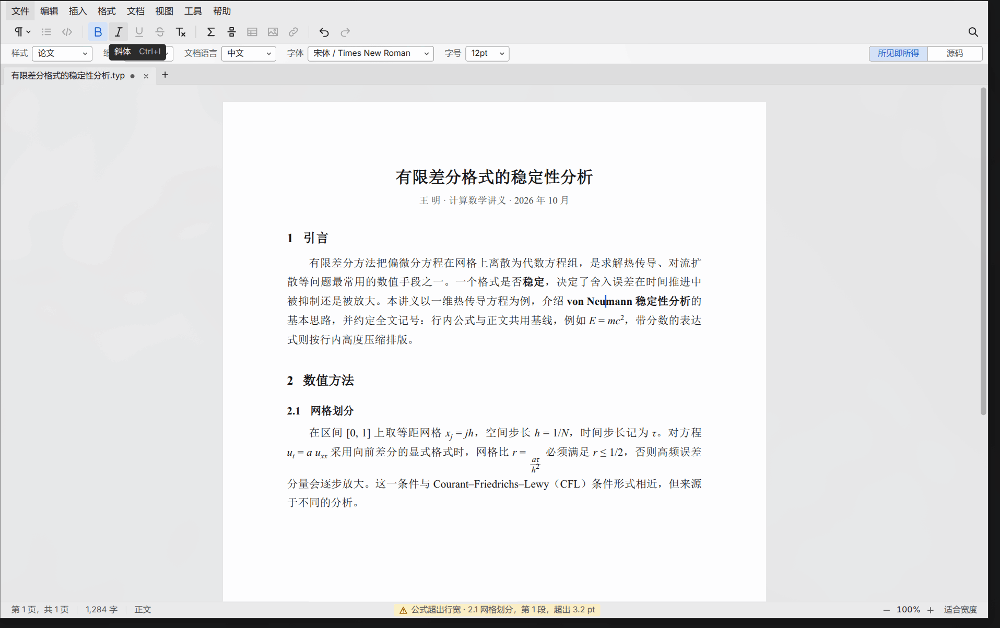
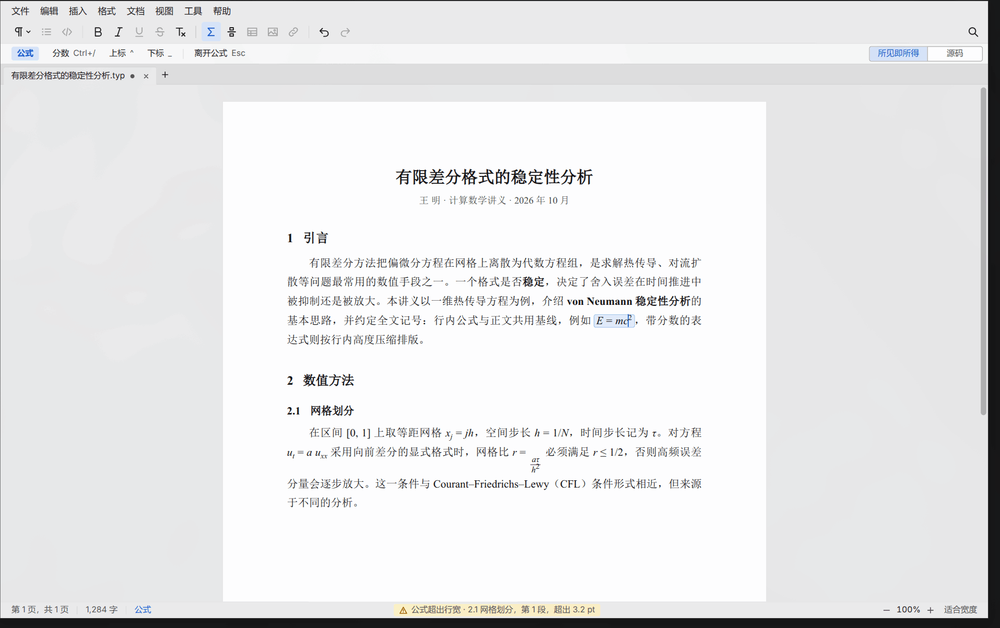
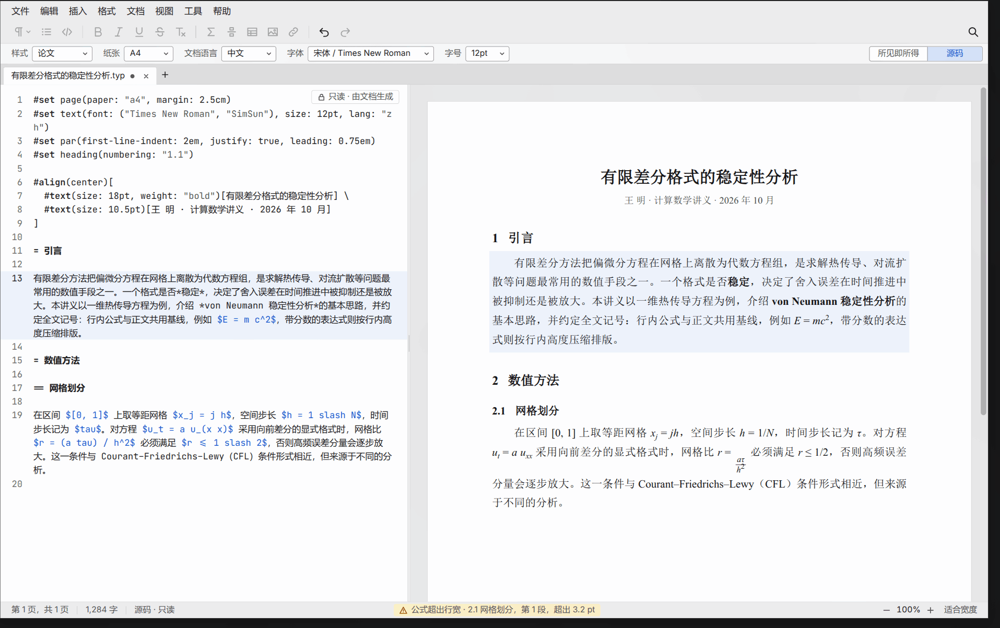
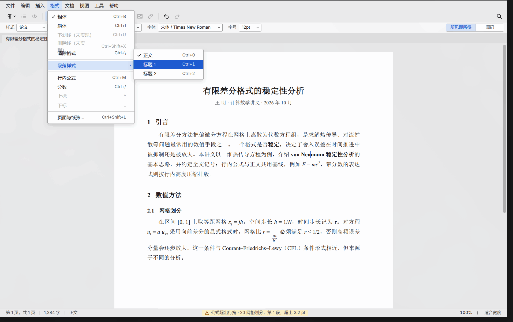
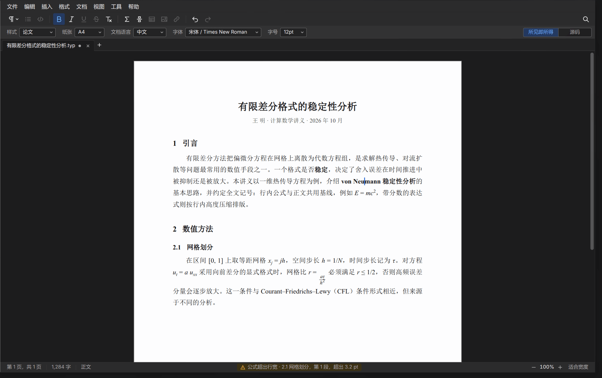
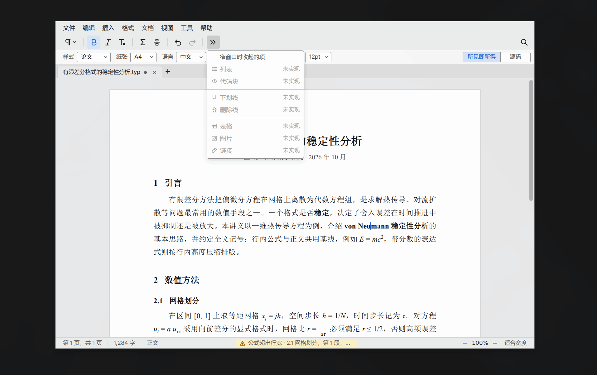
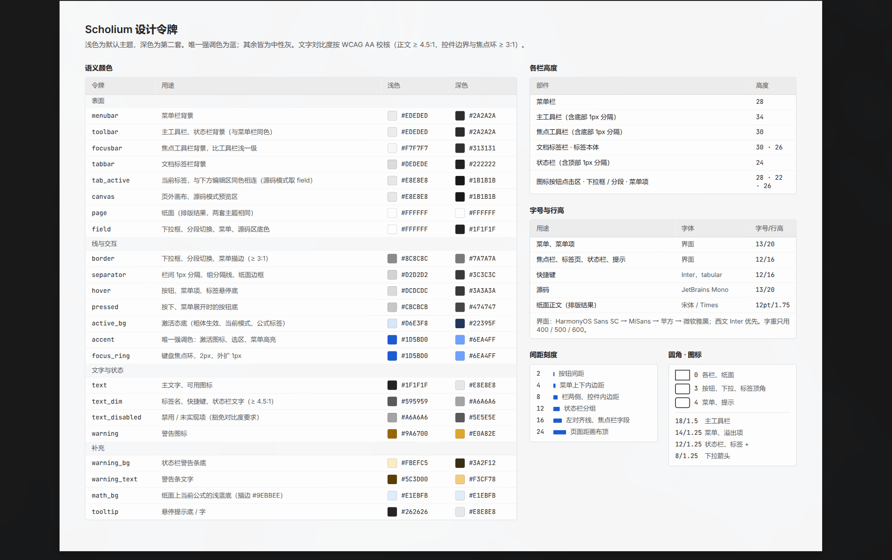
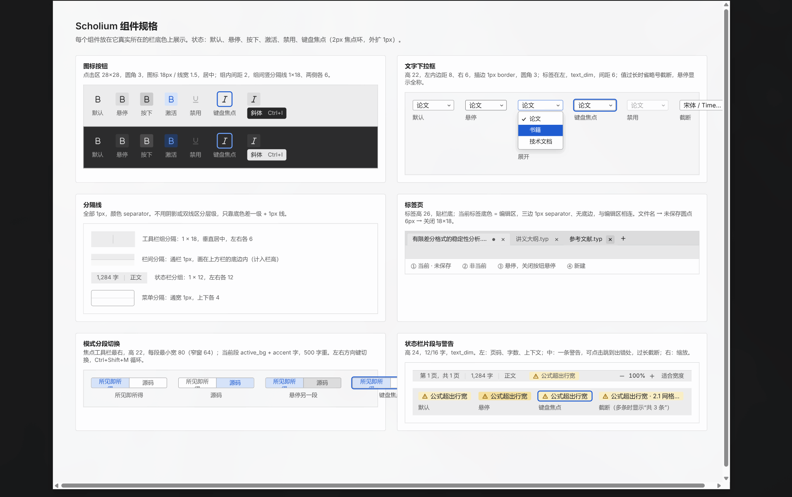

# P1 排版工作区规划

本页规划[阶段 1](ROADMAP.md#阶段-1最小编辑保存与格式交换闭环)的应用壳与编辑入口。
产品定位为科学排版软件，服务论文、书籍、技术文档和研究写作；P1 的基础文本、数学与文件闭环是实现子集，
不能据此把产品收窄成笔记软件。本页作为后续实施与评审的布局基准，不要求逐像素复刻，也不表示对应功能已经实现或通过验收。
正式界面沿用 Rust / egui 原生路线；设计稿仅表达布局、令牌与操作关系，不作为应用 UI 技术验证依赖。

## 如何参照执行

开工前先读[体验规范的工作区原则](../EXPERIENCE.md#工作区组织)，再按本页安排布局与操作入口。
原则约束交互关系，参考图与令牌表帮助理解空间关系和视觉层级，具体控件服从原生平台、可访问性和真实编辑需要。

| 层级 | 执行方式 |
|---|---|
| 必须保持的原则 | 科学排版定位；所见即所得是单一编辑面；源码与预览同等重要；文件操作归属文件菜单；正文优先；权威模型及构建状态不含混 |
| 默认起点 | 自上而下为菜单栏、主工具栏、焦点工具栏、文档标签栏、编辑区、状态栏；源码与预览约 1:1；文件导航和诊断默认收起；菜单、工具栏、焦点工具栏与快捷键调用同一命令 |
| 可自行优化的细节 | 字体回退、图标、几像素间距、菜单分组顺序、缩放策略、窄窗口折叠方式；可因平台和文档类型调整 |
| 不应照搬的示例 | 示例文稿、作者、菜单中尚未交付的能力、设计稿中的纸面排版细节（纸面由 Typst 实际排版）、截图的滚动与裁切 |

日常细节调整不另设确认门槛：实现者应根据可读性、空间利用、键盘/IME 与无障碍表现作判断。
改变主要区域关系或工作方式时，同一变更先更新对应规范与本页，并在评审说明中给出原因及前后界面对照；
不必为颜色或几像素差异修改整套规划。阶段范围仍由路线图约束，不能因为图上有某个入口就提前扩展 P1。

## 布局变更：由 Ribbon 改为三栏工具区

早期规划采用 Office 式 Ribbon。实际实现后，Ribbon 约占 170 逻辑像素，分组空旷、层级混乱，
与科学排版软件的使用方式不符；[路线图](ROADMAP.md)阶段 1 本就写明“标准菜单与紧凑工具栏”。
新布局参考 Mogan 的菜单栏、图标栏与随焦点变化的上下文栏三层结构（只借鉴结构，不复用其实现，
见[开发规范](../../AGENT.md)第 1 条），以及 [ArtCraft / PhotoCraft / WordCraft 借鉴计划](ARTCRAFT_REFERENCE.md)中的设计令牌做法。
顶部四栏合计 122 逻辑像素，比 Ribbon 节省约 50 像素且每栏职责单一。
本页的设计稿（2026-10-14 由 Claude Design 按本项目需求生成）替代此前的工作区草图。

## 参考图

设计稿保存在仓库内，来源与维护方式见[素材说明](assets/p1-ui/README.md)。页面内正文由 Typst 实际排版，
设计稿中的纸面内容只是示意；以下所有图都不作为像素验收样本。

### 所见即所得：光标在正文

### 所见即所得：光标在公式

### 源码：源码与排版结果并重

### 菜单展开

### 深色主题与窄窗口

### 设计令牌与组件规格

## 两种工作方式

### 所见即所得

页面中的排版内容就是编辑对象：光标、选区、中文输入、结构数学和焦点都在这里工作。
即时排版直接更新该编辑面，**不在右侧重复显示预览**，也不为独立预览预留空栏。
默认收起文件导航和诊断；页面视口使用标签栏以下、状态栏以上的全部空间。
连续编辑、分页显示与最终排版检查是视图职责，不把排版软件等同于一个带预览的小型笔记页。

正文纸张边距由排版样式决定，工作区外边距保持紧凑。编辑区按缩放与窗口宽度显示内容，
不能靠缩小正文和放大空白来制造“简洁”。纸面在深浅两套主题中都是白色排版结果。
LaTeX 发布目标的最终检查由“文档”菜单按需打开，不占据日常所见即所得布局。

### 源码与预览

主工作区分为左右两个同等重要的窗格：左侧源码，右侧排版结果，默认 **50% / 50%**。
比例按扣除文件导航后的剩余宽度计算；分隔条可拖动、用键盘调整并恢复等宽。
源码窗格显示语言、文件或生成视图来源（生成视图标“只读 · 由文档生成”）；预览窗格显示实际后端、同步/过期和构建状态。
预览支持缩放、适合宽度与点击定位，不使用固定 220–300 像素的小型缩略图代替工作预览。

同一文档切换工作方式不改变权威模型：

- 原生项目的源码为生成视图；显式开始编辑后成为独立草稿，检查并应用后才修改正文。
- 外部 `.tex` / `.typ` 项目直接编辑权威源文件；语法错误仍能保存，使用对应原生后端构建。
- 切换可查看的生成方言不等于切换可写语言；有草稿时须先提交、保存或显式处置，再进入另一语言写入。
- 草稿未应用或构建失败时，保留上次成功排版并明确它对应的内容版本，不伪装当前草稿已经生效。

## 区域与空间分配

窗口标题栏与最小化、最大化、关闭按钮由操作系统提供，应用不自绘；文档名与修改标记显示在系统标题中。

| 区域 | 高度（逻辑像素） | 布局与职责 |
|---|---|---|
| 菜单栏 | 28 | 文件 编辑 插入 格式 文档 视图 工具 帮助；纯文字、左对齐，样式朴素如原生菜单。菜单树由命令注册表生成 |
| 主工具栏 | 34（含底部 1px 分隔） | 纯单色线性图标，按组用竖分隔线隔开；每个图标有悬停提示“名称 + 快捷键”；当前格式生效时为激活态；未实现项灰显保留位置；最右侧为命令搜索 |
| 焦点工具栏 | 30（含底部 1px 分隔） | 内容随光标所在节点变化：正文中显示文档属性（样式、纸张、文档语言、字体、字号的文字下拉框）；公式中显示“公式”标记与分数、上标、下标、离开公式。最右侧固定为“所见即所得 / 源码”分段切换 |
| 文档标签栏 | 30（标签本体 26） | 位于三栏工具区下方、编辑区上方；每个文档一个标签（文件名、未保存圆点、关闭），当前标签与编辑区同色相连，末尾“+”；只有一个文档时也显示 |
| 主编辑工作区 | 余下全部 | 所见即所得为居中 A4 页面与浅灰画布；源码模式为等宽双窗格，二者互斥 |
| 可选辅助面板 | — | 文件导航与诊断由“视图”菜单展开；诊断也可由状态栏展开；均默认不挤占正文 |
| 状态栏 | 24（含顶部 1px 分隔） | 左：页码、字数、当前上下文（正文 / 公式 / 源码 · 只读）；中：一条可截断的警告，点击跳到出错位置，多条时显示条数；右：缩放与适合宽度。修订号、后端等开发信息不常驻，放入悬停提示或诊断面板 |

窄窗口（如 1024×700）时，主工具栏放不下的按钮按组收进“»”溢出菜单，焦点工具栏下拉框收窄并截断，
菜单栏、模式切换与命令搜索始终可见。辅助导航展开时建议约 166–220 逻辑像素并允许调整，源码与预览继续平分余下宽度。
正式桌面应依据可读字号选择保留分屏或切换单窗格，不能默认把预览缩成缩略图。
这些尺寸需要在原生字体、DPI、输入法与辅助功能环境下检验；不可牺牲文字或点击目标可用性。

## 菜单、工具栏与焦点工具栏组织

菜单、主工具栏、焦点工具栏、溢出菜单、命令搜索与快捷键都来自同一命令注册表（[借鉴计划](ARTCRAFT_REFERENCE.md)采纳项 1），
启用、选中状态与不可用原因由命令判定统一给出；不同入口不得各自维护一份命令或快捷键。

- **文件**：新建、打开、最近打开、保存、另存为、导出、关闭。打印入口属于整体产品规划，单独确定交付阶段。
- **编辑**：撤销、重做、剪切、复制、粘贴、查找与替换。
- **插入**：行内/独立公式、分数、根式、上下标与定界符；以后扩展表格、图片、链接、引用等文档对象。
- **格式**：粗体、斜体、下划线、删除线、清除格式；段落样式子菜单（正文、标题 1、标题 2）。
- **文档**：样式与模板、页面与纸张、文档语言、正文字体与字号、最终排版检查；能力按阶段开放。
- **视图**：工作方式、文件导航、诊断、缩放与分屏、主题；改变显示不应修改文档内容。
- **工具**：命令搜索、偏好设置；以后扩展格式转换等工具。
- **帮助**：快捷键、命令说明与应用信息。

主工具栏分组：段落样式与结构（列表、代码块）｜文字格式（粗体、斜体、下划线、删除线、清除格式）｜
插入（行内公式、分数、表格、图片、链接）｜历史（撤销、重做）｜命令搜索（最右）。

未接入的能力在菜单、工具栏与溢出菜单中置灰，原因放在悬停提示里，不写进标签文字；
只读生成源码、组合输入等状态不能因切换入口而绕过写入门禁。
剪贴板和格式命令须保留页面语义光标/选区，完成后继续在页面输入，不引入第二个正文编辑区。

导出从文件菜单进入模态流程，不常驻按钮卡片；兼容报告列出降级、阻断、源位置和依赖。
输出锁定 revision，未解决问题阻止正式输出；保存写当前项目，另存为创建独立项目，导出生成副本。
恢复在重新打开异常会话时触发，显示可恢复正文动作与独立草稿，不做成一个日常工作标签。
外部文件冲突按事件触发比较与解决界面，不静默覆盖磁盘内容或本地修改。

## 设计令牌

浅色为默认主题，深色为第二套。唯一强调色为蓝，其余为中性灰；文字对比度按 WCAG AA
（正文 ≥ 4.5:1，控件边界与焦点环 ≥ 3:1）。实现时所有界面颜色、圆角与尺寸都从令牌读取，控件内不得硬编码颜色。

| 令牌 | 用途 | 浅色 | 深色 |
|---|---|---|---|
| menubar | 菜单栏背景 | `#EDEDED` | `#2A2A2A` |
| toolbar | 主工具栏、状态栏背景 | `#EDEDED` | `#2A2A2A` |
| focusbar | 焦点工具栏背景，比工具栏浅一级 | `#F7F7F7` | `#313131` |
| tabbar | 文档标签栏背景 | `#DEDEDE` | `#222222` |
| tab_active | 当前标签，与下方编辑区同色相连（源码模式取 field） | `#E8E8E8` | `#1B1B1B` |
| canvas | 页外画布、源码模式预览区 | `#E8E8E8` | `#1B1B1B` |
| page | 纸面（排版结果，两套主题相同） | `#FFFFFF` | `#FFFFFF` |
| field | 下拉框、分段切换、菜单、源码区底色 | `#FFFFFF` | `#1F1F1F` |
| border | 下拉框、分段切换、菜单描边 | `#8C8C8C` | `#7A7A7A` |
| separator | 栏间 1px 分隔、组分隔线、纸面边框 | `#D2D2D2` | `#3C3C3C` |
| hover | 按钮、菜单项、标签悬停底 | `#DCDCDC` | `#3A3A3A` |
| pressed | 按下、菜单展开时的按钮底 | `#CBCBCB` | `#474747` |
| active_bg | 激活态底（格式生效、当前模式、公式标签） | `#D6E3F8` | `#22395F` |
| accent | 唯一强调色：激活图标、选区、菜单高亮 | `#1D5BD0` | `#6EA4FF` |
| focus_ring | 键盘焦点环（2px，外扩 1px） | `#1D5BD0` | `#6EA4FF` |
| text | 主文字、可用图标 | `#1F1F1F` | `#E8E8E8` |
| text_dim | 标签名、快捷键、状态栏文字 | `#595959` | `#A6A6A6` |
| text_disabled | 禁用与未实现项 | `#A6A6A6` | `#5E5E5E` |
| warning | 警告图标 | `#9A6700` | `#E0A82E` |
| warning_bg | 状态栏警告底 | `#FBEFC5` | `#3A2F12` |
| warning_text | 警告文字 | `#5C3D00` | `#F3CF78` |
| math_bg | 纸面上当前公式的浅蓝底（描边 `#9EBBEE`） | `#E1EBFB` | `#E1EBFB` |
| tooltip | 悬停提示底（字色取对侧主题 text） | `#262626` | `#E8E8E8` |

| 尺寸类 | 取值 |
|---|---|
| 栏高 | 菜单栏 28；主工具栏 34；焦点工具栏 30；标签栏 30（标签 26）；状态栏 24 |
| 控件高 | 图标按钮点击区 28×28；下拉框与分段切换 22；菜单项 26 |
| 字号/行高 | 菜单与菜单项 13/20；焦点栏、标签、状态栏、提示 12/16；快捷键 Inter 等宽数字 12/16；源码 JetBrains Mono 13/20 |
| 间距刻度 | 2 按钮间距；4 菜单上下内边距；8 栏两侧与控件内边距；12 状态栏分组；16 左对齐线与焦点栏字段；24 页面距画布顶 |
| 圆角 | 0 各栏与纸面；3 按钮、下拉框、标签顶角；4 菜单与提示 |
| 图标 | 主工具栏 18 / 线宽 1.5；菜单与溢出项 14 / 1.25；状态栏与标签“+” 12 / 1.25；下拉箭头 8 / 1.25 |

界面字体：中文按 HarmonyOS Sans SC → MiSans → 苹方 → 微软雅黑回退，西文优先 Inter，等宽 JetBrains Mono；
字重只用 400 / 500 / 600。Windows 与 macOS 使用系统中文字体；在 Linux 随程序打包中文界面字体前，
须按许可证政策审查其许可（HarmonyOS Sans、MiSans 为各自的免费商用许可，不是 OFL）。纸面正文是排版结果，不属于界面字体。

## 组件规格

| 组件 | 规格 |
|---|---|
| 图标按钮 | 点击区 28×28，圆角 3，图标居中；组内间距 2，组间竖分隔线 1×18、两侧各 6；状态：默认、悬停（hover）、按下（pressed）、激活（active_bg + accent 图标）、禁用（text_disabled）、键盘焦点（focus_ring）；悬停提示“名称 + 快捷键” |
| 文字下拉框 | 高 22，左内边距 8、右 6，1px border，圆角 3；标签在左（text_dim，间距 6）；值过长以省略号截断，悬停显示全称；展开列表当前项带勾选 |
| 分隔线 | 一律 1px separator；栏间分隔画在上方栏底边内（计入栏高）；状态栏分组 1×12、两侧各 12；菜单分隔通宽、上下各 4。不用阴影或双线区分层级 |
| 标签页 | 高 26，贴栏底；当前标签底色等于编辑区，三边 1px separator、无底边；文件名 → 未保存圆点 6 → 关闭按钮 18×18 |
| 模式分段切换 | 焦点工具栏最右，高 22；当前段 active_bg + accent 字、字重 500；左右方向键切换 |
| 状态栏片段与警告 | 高 24，12/16，text_dim；警告用 warning_bg 底与 warning_text 字，可聚焦、可点击跳转，过长截断，多条时显示“共 N 条” |

## 实施时要修正的设计稿问题

- “格式”菜单中“删除线（未实现）”换行并压住下一项：菜单宽度按最长标签计算，标签不写“（未实现）”，原因放悬停提示。
- 组件规格中模式分段切换每段最小宽 80 时“所见即所得”被挤成两行：每段最小宽度改为按文字测量，不小于 96。
- “页面与纸张…”出现在“格式”菜单：归入“文档”菜单。
- 设计稿纸面中分数行内下沉、标题带编号等是示意内容；纸面一律以 Typst 实际排版为准，标题编号随文档模板另行规划。

## 已确认决策

以下各项改变既有交互，已由用户于 2026-10-14 确认，界面实施按此执行。

1. **段落样式与工作方式的快捷键。** Ctrl+0 / Ctrl+1 / Ctrl+2 设正文、标题 1、标题 2；工作方式改用 Ctrl+Shift+M 循环。
   原先 Ctrl+1 / Ctrl+2 切换工作方式的绑定随界面实施移除。段落样式远比切换工作方式常用。
2. **公式中的 Esc。** Esc 先取消选区与输入法组合；二者都没有且光标在公式中时，离开当前公式，光标停在公式之后。
   方向键离开行内环境的规则不变，见[编辑体验](../EXPERIENCE.md)文本模式。
3. **焦点工具栏中的文档属性。** 文档样式当前是固定常量：焦点工具栏显示实际取值，但下拉框禁用，悬停说明尚未开放；
   可编辑文档属性另行规划。
4. **菜单栏实现。** Linux 上 winit 窗口没有系统级菜单栏可接入：各平台先统一由应用绘制原生风格菜单栏；
   macOS / Windows 的原生菜单经验证后另立任务。

## P1 实施边界

设计稿使用同一篇技术文稿呈现各状态；文稿只采用段落、标题、强调与基础公式作为内容示例。
显示的纸张、作者与文档属性用于检验排版工作区的空间关系，并不表示完整模板系统或可编辑文档属性已经交付。
源码与页面是设计示意，不能作为两种编译器渲染一致、源码可编辑或 round-trip 通过的证据。

P1 仍以原生编辑、Action/undo、保存重开、强杀恢复、最小 Source Studio、受支持子集源码/PDF 交换为出口。
完整焦点工具栏、结构大纲、复杂文档对象按阶段 2 扩展；完整 source lens、混用和双目标按阶段 3 扩展。
协作、非线性历史等面板依各阶段接入，避免将尚未可用的功能堆到主界面。

所有正文写入产生 Action；草稿单独持久化。编译不阻塞输入、导航或保存；过期映射必须校验后才能定位。
真实焦点、TreeCursor、IME、读屏和键盘操作在原生实现中验收；设计稿不能替代这些门禁。
实施前置继续遵守[阶段 1 接手门禁](../spikes/SPK-0012-exit-criteria.md#阶段-1-接手门禁不继续扩充-p0)。

## 实施与评审检查

每次涉及应用壳或主要布局的变更，按相关项检查；这是布局评审依据，不代替阶段出口与原生编辑验收。

- 默认进入所见即所得后，页面可直接编辑，没有常驻的重复预览或为其留下的空栏。
- 顶部只有菜单栏、主工具栏、焦点工具栏与标签栏四栏，高度符合令牌；应用不自绘窗口标题与窗口按钮。
- 光标在正文与公式之间移动时，焦点工具栏随之切换，状态栏上下文同步变化；切换不修改文档 revision。
- 菜单、工具栏、溢出菜单、命令搜索与快捷键来自同一命令注册表；未接入入口明确禁用并在提示中说明原因。
- 切换源码时，左右窗格初始接近等宽；调整窗口、分隔条或导航栏后，两边仍能完成实际编辑/查看任务。
- 新建、打开、保存、另存为、导出在文件菜单中可找到；常用操作可由工具栏和键盘访问。
- 点击粘贴、公式、段落样式后，输入继续落在原页面光标。
- 切换工作方式不改变权威模型；生成源码、草稿与外部源文件的可写性和保存含义清楚。
- 草稿错误或构建失败仍能保存；旧排版结果的后端、revision 和过期状态可在悬停提示或诊断面板中查到。
- 1×、1.5×、2× 缩放与 1440×900、1024×700 窗口下，深浅两套主题均无文字溢出、换行挤压或遮挡；
  控件、公式和输入法候选不被遮挡；键盘与读屏可访问核心操作。
- 交付时提供原生界面与设计稿的对照图，说明主要偏离及理由；不以设计稿证明真实编辑能力。

依据：[产品定义](../PRODUCT.md)、[编辑体验](../EXPERIENCE.md)、[应用模块](../modules/app.md)、
[Liii STEM 体验调研](../research/LIIISTEM_EXPERIENCE.md)、[路线图](ROADMAP.md)、
[ArtCraft / PhotoCraft / WordCraft 借鉴计划](ARTCRAFT_REFERENCE.md)、[界面多语言计划](I18N.md)。

所见即所得必须直接在排版后的正文与公式上放置光标、拖选和输入。
页面外的块输入框或覆盖整段的普通文本编辑器不满足此要求。命中坐标必须来自同一
文档、revision 与页码的编译字形；输入经语义会话提交，重排后光标跟随新几何。
